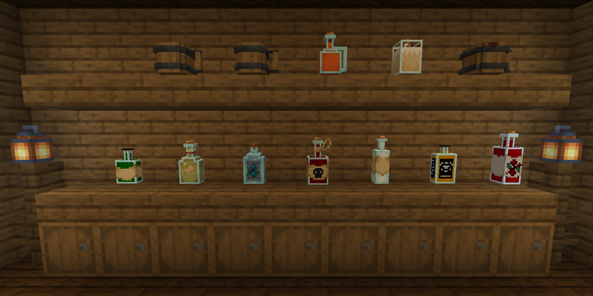
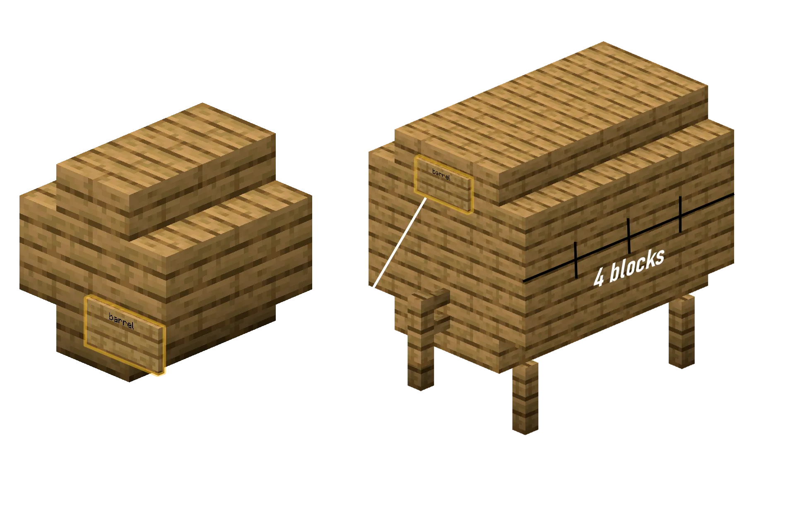

## What is the Brewery?

The **Brewery** lets you brew alcoholic drinks, coffees and **nourishing beverages** that give Saturation and can replace solid food. These are everyday drinks, not Beyonder potions, which are covered in [Brewing and Potions](/magic/brewing/).

Most brews have their own 3D bottle model.

## How does brewing work?

A perfect 5-star bottle takes up to four steps:

1. **Ferment** by boiling ingredients in a heated cauldron for a set time, then collecting them in glass bottles.
2. **Distill** the mixture in a brewing stand with Glowstone Dust. Only high-proof spirits need this.
3. **Age** the bottles in wooden barrels over several Minecraft "years".
4. **Seal** the finished bottle in a Brew Sealing Table to freeze its quality and age forever.

## Boiling

Every brew begins in a boiling cauldron.

1. Place a cauldron filled with water over a heat source, such as a campfire, fire, magma or lava.
2. Right-click the cauldron with the ingredients from the recipe.
3. Right-click the boiling cauldron with a **Clock** to see how long the ingredients have been cooking. The bubble particles also change colour over time, so you can time recipes without a clock.
4. When boiling is done, right-click the cauldron with empty **Glass Bottles** to collect the base mixture.

## Distillation

Hard liquors and spirits need distillation.

1. Put your boiled bottles in the bottom three slots of a **Brewing Stand**.
2. Put **Glowstone Dust** in the top slot. It is used up as the brew distills.
3. Each pass through the brewing stand counts as one "distill run". Over-distilling lowers the quality or ruins the brew.

## Barrel Aging

Aging improves quality and changes a drink's description and flavour, depending on the barrel's wood. A recipe that needs a Spruce barrel only reaches top quality in a barrel built entirely of Spruce.

Brews age by themselves inside a registered barrel. Each Minecraft "year" takes **20 real-world minutes**.

## Barrel Structures

You can build two sizes of barrel from any of 13 materials: Birch, Oak, Jungle, Spruce, Acacia, Dark Oak, Crimson, Warped, Mangrove, Cherry, Bamboo, Pale Oak and Cut Copper.

An ordinary Minecraft **Barrel** block also ages brews. It holds up to 6 brews and counts as Oak.

### Small Barrel (Holds 9 Brews)

1. Place 4 wooden stairs of your choice in a 2x2 square on the ground, facing inward.
2. Place another 4 stairs directly on top of them, facing inward, to form a hollow 2x2x2 block.
3. Place a sign on the front and write `barrel` on the first line.
4. Right-click the sign to register. You should see `Barrel created!` in chat.

### Large Barrel (Holds 27 Brews)

1. Place 4 fence posts on the ground as the legs of a 3x3x4 cylinder.
2. Build the horizontal cylinder, 3 blocks wide and 4 blocks long:
    - **Bottom layer.** 4 stairs on the left, 4 stairs on the right, 4 planks down the centre.
    - **Middle layer.** 4 planks on the left, 4 planks on the right, 1 plank at the front centre and 1 plank at the back centre. Leave the core hollow.
    - **Top layer.** 4 stairs on the left, 4 stairs on the right, 4 planks down the centre.
3. Place a fence post on the bottom middle plank of the front face. This is the spigot.
4. Place a sign directly above the spigot, on the middle plank, and write `barrel` on the first line.
5. Right-click the sign to register.

## The Sealing Table

Unsealed brews keep changing in your inventory or storage. Sealing locks a brew's quality and stops it aging, so seal finished brews before you sell or store them.

The Sealing Table is placed as a **Smoker** block, but a normal Smoker will not seal brews. Craft it with **2 Glass Bottles** on the top row of a crafting table and **4 Wood Planks** below them. Put your finished brew in the Sealing Table and click to seal it.

## Drunkenness & Hangover Mechanics

Alcoholic drinks raise your drunkenness percentage, which causes these effects:

1. **Stumbling.** You stumble in random directions.
2. **Drunk speech.** Your chat messages are distorted. S becomes `sh`, words get mixed up, and you randomly hiccup (`*hic*`) or burp (`*burp*`).
3. **Drunk signs.** Text you write on signs comes out garbled.
4. **Vomiting.** If your alcohol level is too high, you throw up and drop items you cannot pick up, like `SOUL_SAND`, `ROTTEN_FLESH` and `BEETROOT`.
5. **Waking up.** If you log out while very drunk, you may "wake up" at one of the wake-up points staff have set when you come back. While extremely drunk you may also need several tries to log in.

A hangover is remembered for **7 days** after you log out, so logging off is not a cure.

### Sobering Up

These items lower your drunkenness or cure a hangover:

| Item | Lowers alcohol by |
|:---|:---|
| Golden Apple | **10** |
| Bread | **4** |
| Honey Bottle | **3** |
| Milk Bucket | **2** |
| Water Bucket | **2** |
| Carrot | **2** |

## The Recipe Book

Follow a recipe exactly to get a **5-star Quality** brew. A "-" in the **Aging** column means the brew is ready as soon as it is bottled.

If a brew comes out ruined, hover over it. The tooltip gives hints like `Too much time in the oven...` or `One of the ingredients doesn't taste good...` to help you fix the recipe.

### Saturation and food-replacing brews

These give the **Saturation** effect, so you can skip solid food.

| Name                    | Ingredients                                                       | Boil Time | Distill Runs |    Aging     | Potion Effects                                                | Description                                                                    |
|:------------------------|:------------------------------------------------------------------|:---------:|:------------:|:------------:|:--------------------------------------------------------------|:-------------------------------------------------------------------------------|
| **Dwarven Stout**       | 8 Wheat, 4 Sweet Berries, 1 Coal                                  |  10 min   |      0       |   Oak (6y)   | Saturation I-II Resistance I (1-2m) Slowness I (15s)    | A heavy, smoky stout that tastes of earth and hearth. Extremely filling.       |
| **Liquid Bread**        | 4 Bread, 4 Wheat, 2 Sugar                                         |  6 min    |      0       |  Birch (2y)  | Saturation II-III Regeneration I (10-30s)                  | The ultimate survival drink, favoured by fasting monks. Literally liquid bread. |
| **Elven Honeymead**     | 8 Sugar Cane, 2 Honey Bottles, 4 Melon Slices                     |  5 min    |      0       | Acacia (15y) | Saturation II Speed I (1-2m) Regeneration I-II (10-20s) | Sweet as liquid sunlight. Can sustain a traveler for days in the wilderness.   |
| **Golden Feast Elixir** | 2 Golden Carrots, 1 Glowstone Dust, 6 Sweet Berries, 4 Sugar Cane |  12 min   |      1       | Spruce (10y) | Saturation IV-V Glowing I (60s) Speed I-II (30-60s)     | A shimmering, magical golden broth that cures even extreme hunger.             |

### Chaotic and funny brews

| Name                       | Ingredients                                                 | Boil Time | Distill Runs |     Aging     | Potion Effects                                                                                   | Description                                                                         |
|:---------------------------|:------------------------------------------------------------|:---------:|:------------:|:-------------:|:-------------------------------------------------------------------------------------------------|:------------------------------------------------------------------------------------|
| **Gnomish Giddy Juice**    | 2 Red Mushrooms, 2 Brown Mushrooms, 4 Glow Berries, 4 Sugar |  4 min    |      2       |   Oak (1y)    | Saturation I Nausea I-II (20-40s) Jump Boost II-IV (30-60s) Glowing I (30s)             | A bubbly, glowing pink concoction. Makes you jump high and feel incredibly giddy!   |
| **Pirate's Grog**          | 6 Kelp, 10 Sugar Cane, 6 Melon Slices                       |  8 min    |      2       | Dark Oak (5y) | Saturation I-II Water Breathing I (1-2m) Hero of the Village I (30s)                       | Spicy, salty grog that keeps the scurvy away and makes you feel like a pirate king. |
| **Glowing Mushroom Vodka** | 10 Potatoes, 3 Red Mushrooms, 3 Brown Mushrooms             |  18 min   |      5       |       -       | Weakness (80s) Nausea (27s) Night Vision (50-80s) Blindness (2-12s) Slowness (3-10s) | A psychedelic brew. Literally glows in the dark and distorts reality.               |

### Classic beers and ales

| Name          | Ingredients | Boil Time | Distill Runs |     Aging     | Lore / Description           |
|:--------------|:------------|:---------:|:------------:|:-------------:|:-----------------------------|
| **Wheatbeer** | 3 Wheat     |  8 min    |      0       |  Birch (2y)   | Refreshing and crisp.        |
| **Beer**      | 6 Wheat     |  8 min    |      0       |   Any (3y)    | The traditional pub ale.     |
| **Darkbeer**  | 6 Wheat     |  8 min    |      0       | Dark Oak (8y) | Roasted, deep, malty flavor. |

### Wines, meads and ciders

| Name            | Ingredients            | Boil Time | Distill Runs |   Aging   | Potion Effects         | Description                                         |
|:----------------|:-----------------------|:---------:|:------------:|:---------:|:-----------------------|:----------------------------------------------------|
| **Red Wine**    | 5 Sweet Berries        |  5 min    |      0       | Any (20y) | None                   | Full-bodied, requires deep barrel aging.            |
| **Mead**        | 6 Sugar Cane           |  3 min    |      0       | Oak (4y)  | None                   | Classic honey-like wine.                            |
| **Apple Mead**  | 6 Sugar Cane, 2 Apples |  4 min    |      0       | Oak (4y)  | Water Breathing (150s) | Sweet apple mead that helps you breathe underwater. |
| **Apple Cider** | 14 Apples              |  7 min    |      0       | Any (3y)  | None                   | Sweet, refreshing apple cider.                      |

### Spirits and liquors

High-alcohol drinks that need distillation. In Old Tom Gin, "Blue Flowers" means Cornflowers or Blue Orchids.

| Name                        | Ingredients                      | Boil Time | Distill Runs |    Aging     | Potion Effects                                                | Description                                                 |
|:----------------------------|:---------------------------------|:---------:|:------------:|:------------:|:--------------------------------------------------------------|:------------------------------------------------------------|
| **Calvados (Apple Liquor)** | 12 Apples                        |  16 min   |      3       | Acacia (6y)  | None                                                          | Sour like acid at worst, a premium brandy at best.          |
| **Scotch Whiskey**          | 10 Wheat                         |  10 min   |      2       | Spruce (18y) | None                                                          | A single-malt whiskey with deep wood notes.                 |
| **Golden Rum**              | 18 Sugar Cane                    |  6 min    |      2       |  Oak (14y)   | Fire Resistance (20-100s) Poison (0-30s)                   | Warm spiced gold rum that grants temporary fire protection. |
| **Russian Vodka**           | 10 Potatoes                      |  15 min   |      3       |      -       | Weakness (15s) Poison (10s)                                | A harsh potato spirit. Almost undrinkable at poor quality.  |
| **Old Tom Gin**             | 9 Wheat, 6 Blue Flowers, 1 Apple |  6 min    |      2       |      -       | None                                                          | Infused with the delicate taste of juniper.                 |
| **Tequila Anejo**           | 8 Cactus                         |  15 min   |      2       | Birch (12y)  | None                                                          | Spirit of the desert, aged in birch wood.                   |
| **Strong Absinthe**         | 15 Grass                         |  3 min    |      6       |      -       | Poison (15-25s)                                               | High-proof herbal liquor. Highly toxic but powerful.        |
| **Green Absinthe**          | 17 Grass, 2 Poisonous Potatoes   |  5 min    |      6       |      -       | Poison (25-40s) Instant Damage II Night Vision (40-60s) | A poisonous-looking lime green liquor. Distorts vision.     |
| **Golden Vodka**            | 10 Potatoes, 2 Gold Nuggets      |  18 min   |      3       |      -       | Weakness (28s) Poison (4s)                                 | Shimmering golden vodka.                                    |
| **Blazing Whiskey**         | 10 Wheat, 2 Blaze Powder         |  12 min   |      3       | Spruce (18y) | None                                                          | Gives a burning feeling in your mouth when drunk!           |

### Specialty and sobering brews

Most of these are non-alcoholic or help you sober up. Advocaat is the exception and contains alcohol.

| Name                  | Ingredients                           | Boil Time | Distill Runs |   Aging   | Potion Effects                                         | Description                                          |
|:----------------------|:--------------------------------------|:---------:|:------------:|:---------:|:-------------------------------------------------------|:-----------------------------------------------------|
| **Potato Soup**       | 5 Potatoes, 3 Grass                   |  3 min    |      0       |     -     | Instant Health (stronger at high quality)              | Hot nourishing soup, restores health.                |
| **Strong Coffee**     | 12 Cocoa Beans, 2 Milk Buckets        |  2 min    |      0       |     -     | Speed (30-140s) Regeneration (2-5s) Alcohol: -6% | Perfect for clearing your head and sobering up quickly. |
| **Advocaat (Eggnog)** | 5 Eggs, 2 Sugar, 1 Milk Bucket        |  2 min    |      0       | Any (3y)  | None                                                   | Creamy egg liquor, made with raw egg. Alcoholic.     |
| **Hot Chocolate**     | 3 Cookies                             |  2 min    |      0       |     -     | Haste (40s)                                            | Hot sugary cocoa that gives you energy to mine.      |
| **Iced Coffee**       | 8 Cookies, 4 Snowballs, 1 Milk Bucket |   1 min   |      0       |     -     | Speed (10s) Regeneration (30s) Alcohol: -8%      | The best drink to sober up fast. Cold and sweet.     |
