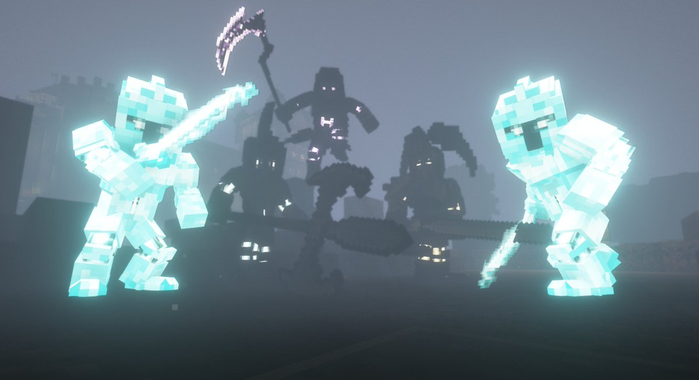
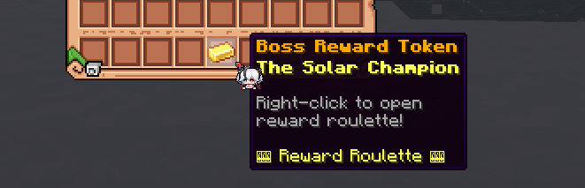
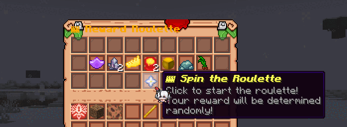
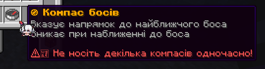

Rift Bosses (once called Guardians) are world bosses, one for each of the 22 Pathways. Each boss appears on a fixed weekly schedule somewhere in the main Overworld, and every player who helps defeat it gets a chance at that Pathway's recipes, Beyonder Characteristics and ingredients.

## When do Rift Bosses spawn?

Every boss has its own weekly time slots, usually two a week. The whole server is warned in chat **30, 15, 5 and 1 minute** before a boss appears.

| Day | Bosses (server time) |
|---|---|
| Monday | Darkness 10:00, Demoness 16:00, Mother 18:00, Black Emperor 20:00, Door 22:00, Hermit 22:00 |
| Tuesday | Error 10:00, Fool 16:00, Moon 22:00, Wheel of Fortune 22:00 |
| Wednesday | Hanged Man 10:00, White Tower 10:00, Chained 14:00, Death 14:00, Paragon 16:00, Red Priest 22:00, Sun 23:00 |
| Thursday | Justiciar 10:00, Tyrant 16:00, Mother 18:00, Twilight Giant 18:00, Abyss 22:00, Hermit 22:00, Visionary 22:00 |
| Friday | Darkness 10:00, Black Emperor 16:00, Demoness 16:00, Door 22:00, Moon 22:00 |
| Saturday | Error 10:00, Chained 14:00, Fool 14:00, White Tower 14:00, Wheel of Fortune 18:00, Twilight Giant 20:00, Hanged Man 22:00 |
| Sunday | Paragon 10:00, Red Priest 14:00, Justiciar 16:00, Death 18:00, Sun 19:00, Abyss 22:00, Tyrant 22:00 |

The times are in the server's time zone. Staff can change the schedule, so trust the chat warnings over this table.

### Where do they appear?

At a random spot in the main Overworld, up to 12,000 blocks from the centre in each direction. Use a **Boss Compass** to find it (see below).

## Which boss belongs to which Pathway?

| Pathway | Boss | Enrage at | Magic-only at |
|---|---|---|---|
| Abyss | The Abyssal Horror | 35% | 20% |
| Black Emperor | The Imperial Sovereign | 35% | 20% |
| Chained | The Chained Devourer | 30% | 20% |
| Darkness | The Shadow Harbinger | 30% | 20% |
| Death | The Eternal Reaper | 30% | 20% |
| Demoness | The Crimson Demoness | 35% | 25% |
| Door | The Dimensional Gatekeeper | 35% | 20% |
| Error | The Paradox Entity | 35% | 20% |
| Fool | The Jester of Madness | 50% | 20% |
| Hanged Man | The Suspended Soul | 30% | 25% |
| Hermit | The Solitary Sage | 25% | 20% |
| Justiciar | The Divine Arbitrator | 30% | 20% |
| Moon | The Lunar Empress | 40% | 25% |
| Mother | The Primal Mother | 30% | 20% |
| Paragon | The Apex Crafter | 30% | 20% |
| Red Priest | The Flame Cleric | 40% | 20% |
| Sun | The Solar Champion | 25% | 15% |
| Twilight Giant | The Colossal Guardian | 40% | 15% |
| Tyrant | The Storm Tyrant | 35% | 15% |
| Visionary | The Mind Seer | 40% | 15% |
| Wheel of Fortune | The Fate Weaver | 30% | 20% |
| White Tower | The Tower Architect | 30% | 25% |

## How does the fight work?

A boss fight has three phases:

1. **Normal.** The boss fights at full strength.
2. **Enrage.** When its health falls to its enrage threshold, the boss **heals back up** to between 60% and 80% of its health and summons **2 Wild Beyonder guards**. If the enrage phase drags on for 10 minutes, it starts dealing x1.2 to x1.5 damage.
3. **Final phase (magic only).** At 15% to 25% health the boss becomes **immune to physical damage**. Only spells hurt it now. It summons **3 more guards**.

:::danger[Bring Beyonders]
A group with no spellcasters cannot finish a boss. The guards it summons scale with the strongest Beyonder in the fight.
:::

### What makes a boss fight hard?

| Rule | Details |
|---|---|
| Scaling | The boss scales with the **total Beyonder power** of nearby players, not with headcount. Power per player: Sequence 9 = 1, 8 = 1.6, 7 = 2.6, 6 = 4.2, 5 = 6.8, 4 = 11, 3 = 18, 2 = 29, 1 = 47. A non-Beyonder counts 0.35 |
| Own-Pathway resistance | A boss takes only **35%** damage from abilities of its own Pathway |
| Damage cap per hit | One hit can take at most **4%** of the boss's health |
| Boss hits | A boss hit deals at most 60 damage |
| Spirituality drain | Within 40 blocks you lose **6% Spirituality every 8 seconds** (more in later phases) |
| Madness | Within 40 blocks you gain Madness every 15 seconds (more in later phases, and Sequence 4 and stronger gain half) |
| No flying | Flight stops working near the boss after 10 seconds |

## What do I get for defeating a boss?

Players who contributed get one or more **Boss Reward Tokens**, named after the boss (for example "Boss Reward Token: The Solar Champion"). The bigger your share of the fight, the more tokens you get. Tokens can be traded or saved.

Right-click a token to open the **Reward Roulette** and spin it. The prize pool holds that Pathway's recipes, Beyonder Characteristics and ingredients from Sequence 9 down to Sequence 1. Common, weaker items are far more likely than rare, strong ones.

Boss kills also give Acting through the World source.

## How do I find a boss?

The **Boss Compass** points to the nearest active boss.

- Right-click it during a boss encounter to switch it on. It works for **30 minutes**.
- It shows the direction and a rough distance, and it disappears when you get close.
- Carry only one at a time.

The Battle Pass includes Boss Compasses among its rewards.

## Related pages

- [Wild Beyonders](/magic/wild-beyonders/): the guards bosses summon
- [Dungeons](/guides/dungeons/): the other group content
- [Spirituality](/magic/spirituality/) and [Madness and Mutation](/magic/mutation/): what the boss drains
- Main site guide: [Activities](https://www.mysterria.net/en/guide/activities)
