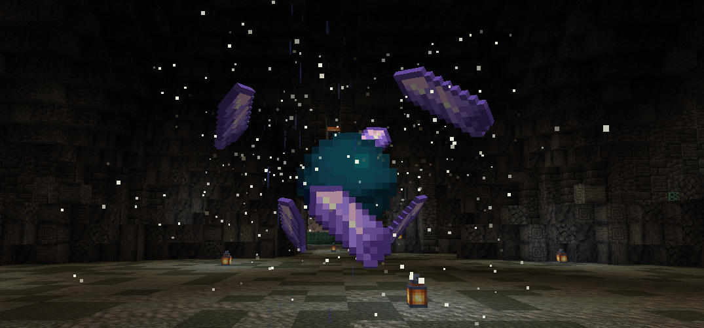
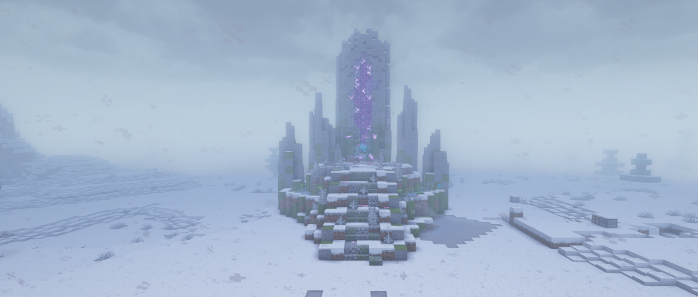

Dungeons are instanced worlds that a party enters through a **Rift** in the Overworld. You get class equipment at the start, fight through rooms to a final boss, and leave with loot, Helping Cards and Acting. Each player has **one life** per run.

## Which dungeons are there?

| Dungeon | Party size | Dungeon power | Setting |
|---|---|---|---|
| **The Shivering Hollow** | 4 | 0 | A frozen underground cavern |
| **Embers Resurgence** | 5 | 100 | A volcanic stronghold |
| **Root of the Canopy** | 4 | 240 | A labyrinth of giant roots |
| **The Dust Citadel** | 3 | 450 | A buried desert fortress |

The Shivering Hollow and Embers Resurgence have two entrances each, the others one. The Shivering Hollow is open to players who are not Beyonders yet.

## How do I find a dungeon?

Type `/subspace`. The menu lists every dungeon with:

- the coordinates of each entrance Rift
- your power compared with the dungeon's
- your cooldowns and card runs left today

A Rift is a pillar of shimmering particles in the world. Walk into it with your party to start.

## How do I enter a dungeon?

1. **Make a party** with `/party` and invite your friends. `/ready` and `/leave` manage the queue.
2. **Go to the Rift** and step into it.
3. **Choose a difficulty** in the "Choose Difficulty" screen.
4. **Pick a class** when the dungeon loads. If you do not choose in time, one is assigned to you.

If your party is smaller than the dungeon's size, you are asked to **Enter Understaffed?** This is only allowed if your power is no more than 150 above the dungeon's power. Overpowered players must bring a full party.

:::note[Empty your hands]
If someone in the party carries certain resources, the dungeon will not start ("Someone in the party is carrying resources!"). Leave valuables at home.
:::

## What is dungeon power?

Your power comes from your Sequence:

| Sequence | 9 | 8 | 7 | 6 | 5 |
|---|---|---|---|---|---|
| Power | 30 | 60 | 100 | 150 | 220 |

| Sequence | 4 | 3 | 2 | 1 | 0 |
|---|---|---|---|---|---|
| Power | 320 | 450 | 600 | 800 | 999 |

You can enter a dungeon only if your power is **at most 29 below** the dungeon's power. Being under-powered also weakens you. In steps at 10, 20 and 29 below the dungeon's power, the damage you deal drops (down to x0.4) and the damage you take rises (up to x1.6). At or above the dungeon's power there is no penalty.

## What are the difficulty tiers?

Every dungeon has four tiers. Harder tiers pay more Acting and better Helping Cards.

| Tier | Power needed | Damage you deal | Damage you take |
|---|---|---|---|
| Normal | Dungeon power | x1.0 | x1.0 |
| Advanced | Dungeon power + 50 | x0.7 | x1.5 |
| Master | Dungeon power + 150 | x0.5 | x1.8 |
| Grandmaster | 450 (Sequence 3) or more | x0.3 | x2.5 |

On Master and Grandmaster you are also always treated as slightly under-powered, on top of these numbers.

## How often can I run a dungeon?

| Run type | How often | What you get |
|---|---|---|
| **Real loot run** | Once every **72 hours** per dungeon | The loot from chests and the boss |
| **Card run** | Up to **2 per dungeon per day** while you are on cooldown | Chests are sealed. You get **1 Helping Card** when you finish |

Most loot drops as **shards** ("Shard of ..."). Right-click while holding enough shards to combine them into the real item. A Sequence 9 recipe or potion needs 2 shards, and stronger items need more, up to 9 for Sequence 0.

### What are dungeon keys?

| Key | Effect |
|---|---|
| **Simple Key** | Resets your own real-loot cooldown for one dungeon |
| **Premium Key** | Resets the cooldown for your party (up to the dungeon's party size), makes the run a real-loot run, and doubles Helping Cards |

Right-click a key and pick the dungeon. Keys come from the Battle Pass and the store.

## What are Helping Cards for?

A **Helping Card** belongs to one dungeon and one tier. Right-click it to open the **Helping Card Shop** and trade cards for rewards. For example, at Embers Resurgence on Master:

| Reward | Cards |
|---|---|
| Ingredient Token | 8 |
| Recipe Token (Sequence 6) | 12 |
| Potion Token (Sequence 6) | 16 |
| Acting Bottle (10,000) | 20 |
| Anti-Control Charm | 24 |
| Ritual Book (Tier I) | 32 |

Root of the Canopy and The Dust Citadel pay their shop rewards as loot shards instead of whole items. Grandmaster shops at Embers Resurgence and Root of the Canopy also sell the [Pathway Transfer Token](/guides/special-items/).

## How much Acting do dungeons give?

Finishing a dungeon gives Acting through the World source. Harder tiers give more (Advanced x1.25, Master x1.5, Grandmaster x2). Dungeon Acting is capped at **600 per day** across all dungeons, resetting at midnight UTC.

## Which class should I pick?

| Class | Magic damage | Physical damage | Notes |
|---|---|---|---|
| **Tank** | x0.3 | x0.6 | High defence, draws mobs to itself |
| **Mage** | x2.2 | x0.15 | Spells hit hard, bare hands are useless |
| **Warrior** | x0.7 | x1.8 | Strong melee, dies fast |
| **Archer** | x0.8 | x0.7 | Bows and crossbows deal x2.2 |
| **Support** | x1.0 | x0.8 | Strong magic defence, full buff access |

Balance the party: one Tank to hold mobs, damage dealers that match your Beyonders, and a Support if you have one.

### Which abilities are banned in dungeons?

These abilities do not work inside a dungeon: Nightmare, Nightmare World, Traveler's Door, Exile, Thread Hands, Threads, Paper Figurine, Pocket Space, Holy Equipment, Lockpick, Wraith Transformation, Puppet Transformation and puppet possession. Some classes also block certain abilities ("Your class cannot use this ability in the dungeon!").

## What about closed Rifts?

A Rift can be closed until players weaken it together. Stand near it, accept "The node is too strong. You can try to weaken it. [Try?]" and survive the defence while it absorbs your shards. Right now every dungeon Rift is open.

## Related pages

- [Rift Bosses](/guides/bosses/): world bosses with their own schedule
- [Special items](/guides/special-items/): the Anti-Control Charm and Pathway Transfer Token from the card shops
- [Acting](/magic/acting/): how World Acting and its caps work
- Main site guide: [Activities](https://www.mysterria.net/en/guide/activities) and the news post [December update 2025](https://www.mysterria.net/en/news/december-update-2025)
