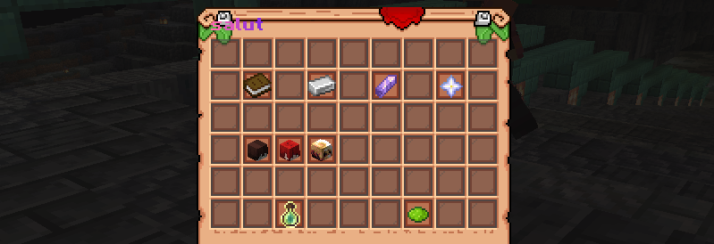
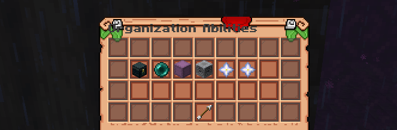
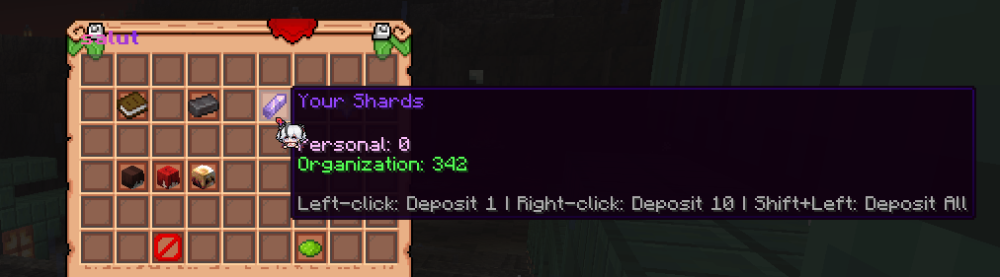

### What are Secret Orders?

A Secret Order is a group of up to ten players with its own treasury, abilities and, later on, a private world of its own. Members fill the treasury together, raise the order's level, and unlock tools that make playing together easier: a shared stash, a meeting space, summons, a lair.

Founding an order needs a **sponsorship** (donation). The order stays active as long as its leader's sponsorship does. Members never pay anything.

Type `/o` to open the order hall. Almost everything below is done from there.

### If the sponsorship ends

- The order keeps its level for **7 days**, so the leader has time to renew.
- After that it **pauses at level 0**. Its progress is kept, not deleted, and comes back the moment the leader renews.
- While paused, members can still **take their items out** of the stash, but can't put new ones in.
- The leader can hand the order to a member who holds a sponsorship with `/o transfer <player>`. If the sponsorship has ended and the leader has been away for 14 days, a vice leader can do the hand-over.

## Levels

The leader raises the level with shards from the order's treasury.

| Level | Name | Cost | Members | Unlocks |
|---|---|---|---|---|
| 0 | Whisper of Mist | - | 3 | Order chat `/oc`, no magic damage between members, invites, vice leaders |
| 1 | Shadow of Mist | 50 | 4 | **Organization Stash**, **SOS Signal**, weekly contracts |
| 2 | Gaze of Mist | 300 | 5 | **Pocket Dimension**, stash page 2 |
| 3 | Embrace of Mist | 1,500 | 6 | **Instant Summon**, **Growth Ritual**, 1st extra member slot, stash page 3 |
| 4 | Heart of Mist | 6,000 | 7 | **Secret Lair**, **Battle Cry**, **Global Announcement**, the other member slots and stash pages |

### Upgrades

Bought once from the Treasury, on top of the level. A locked upgrade shows the level it unlocks at.

- **Member slots:** 200, 400 and 800 shards. With all three, a level 4 order holds **10 members**.
- **Stash pages:** an order starts with one page of 27 slots. Pages 2-6 cost 300, 600, 1,200, 2,400 and 4,800 shards.

## Abilities

| Ability | Level | Who | What it does |
|---|---|---|---|
| Organization Stash | 1 | Everyone | Shared storage for the order's items |
| SOS Signal | 1 | Everyone | `/o sos` posts your coordinates in the order chat |
| Pocket Dimension | 2 | Leader and vices start it, everyone joins | A shared meeting space for 10 minutes. Cooldown 24 hours |
| Instant Summon | 3 | Everyone | Teleports a member to you. Costs 2% of your acting bar. Cooldown 30 minutes |
| Growth Ritual | 3 | Leader and vices | **+25% acting speed** for 24 hours. Cooldown 7 days |
| Secret Lair | 4 | Leader and vices create it, members enter with a teleport item | The order's own permanent world |
| Battle Cry | 4 | Leader and vices | Speed II, Haste I and Regeneration I for 5 minutes and a full food bar, for members within 48 blocks. Costs 60 shards from the treasury. Cooldown 12 hours |
| Global Announcement | 4 | Leader and vices | A message to everyone online, with a sound. Cooldown 24 hours |

**Growth Ritual** only helps Beyonders. Members who are offline when it's cast still get the rest of the 24 hours when they log in. Players who joined the order less than 24 hours before the cast don't get it, so hopping between orders for the buff doesn't work. The ritual counts toward the server's overall acting limits: it gets you to your limits sooner but doesn't raise them.

**Secret Lair:** creating it takes 50 shards, 20 obsidian, 5 ender pearls and 3 diamonds from the creator. Each teleport item costs 10 shards, 1 ender pearl and 2 crying obsidian, and is crafted in the lair menu.

## The treasury

Shards come from selling magical ingredients (see [Energy Shards](/guides/shards/)). There are three ways to put them into the treasury:

- `/o deposit [amount|all]`, or the deposit card in the Treasury.
- **Right-click** the confirm button of `/tradeall` to send the payment straight to the treasury.
- Finishing the **weekly contract** (below).

Every deposit shows the order's next goal and how far away it is. The Treasury also lists the last ten deposits and purchases.

Shards can't be taken back out of the treasury. The only way they return to players is through **commissions**: payment for work done.

## Weekly contracts

From level 1, the order gets a contract every Monday: 2-3 magical ingredients to deliver together. Higher levels are asked for stronger ingredients, and bigger orders for more of them. You can see next week's ingredients in advance.

- Delivered items are used up.
- When the contract is complete, the order earns **1.5x** the villager value of everything asked for. A quarter of that goes to the members who delivered, split by how much each one brought, and the rest goes to the treasury.
- Members who were offline are paid on their next login.
- An unfinished contract stays open for one more week.

Contracts also earn renown, with a bonus at 10, 25 and 50 completed.

## After the last level: projects and unlocks

A maxed order still has things to save up for. In the Treasury, pick an **active project**, and every deposit shows how far along it is.

**Lair projects** (need a created Secret Lair):

| Project | Cost | What it does |
|---|---|---|
| Lair: dawn, dusk, night | 300 each | Keeps the lair sky at that time of day |
| Lair: rain, thunder | 300 each | Keeps that weather in the lair |
| Lair expansion I, II, III | 2,000 / 4,000 / 8,000 | Moves the wall out from 100 to 150, 200 and 250 blocks. Your builds are never touched |
| Lair lectern | 1,000 | Any lectern without a book in your lair opens the stash |
| Lair hearth | 800 | The leader or a vice picks where members arrive in the lair |
| Lair banner | 400 | Hangs the order's banner all around the lair wall |

**Unlocks:**

| Unlock | Cost | What it does |
|---|---|---|
| Stash sorting | 200 | A button that merges stacks and sorts the stash |
| Stash log | 300 | Who put in or took out what, over the last 7 days (leader and vices) |
| Long pocket sessions | 600 | Pocket Dimension sessions last 15 minutes |
| Gold, crimson and mist frames | 75 each | Frames for the Global Announcement |

### Rite of Legacy

When everything else is bought, a maxed order can perform the **Rite of Legacy** again and again from the Treasury. Each rite adds a star to the order's name in `/oc`, `/o top` and the hall. The first costs 3,000 shards, and each one after that costs 1.5x the one before.

## Commissions

The leader or a vice can pay players for work out of the treasury. Hold an item and type:

`/o commission <quantity> <reward> [public|members]`

- Only plain items are accepted: no names, enchantments or damage.
- **Public** commissions (the default) appear on `/commissions` for everyone, so players outside the order can fill them too. `members` keeps a commission inside the order.
- Delivered items go into the stash. Every delivery pays its share of the reward right away, and 10% of each payment is lost as a tax.
- Limits: 5 open commissions, 300 shards per member and 1,000 per order each week. A commission expires after 7 days.

## Renown

Renown grows with what the order does **together**: level-ups, upgrades, projects, Pocket Dimension sessions with 3 or more members, contracts, commissions, rites of Legacy. Shards alone don't buy it, and it never goes down.

| Tier | Renown | Reward |
|---|---|---|
| Known | 50 | Your order's tag before `/oc` messages, in a colour you choose |
| Respected | 150 | An "of &lt;Order&gt;" title for members, more tag colours, the Lair banner at half price |
| Renowned | 400 | A two-colour gradient tag, two more Global Announcement sounds |
| Legendary | 1,000 | A gold name and a star in `/o top` |

- `/o top` lists the most renowned orders. An order only appears there if it opts in with `/o settings public on`, because orders are secret by default.
- `/o settings tag <colour> [colour]` sets the chat tag, and `/o settings tag off` hides it.

## The Tide pool

Each week the whole server fills one shared pool. Orders give from their treasury with `/o tidepool <amount|all>`, and any player can add with `/patron` offerings. If the pool reaches its goal, the order that gave the most **picks a Tide day** for the next week and holds the Seat at spawn. The same order can't win two weeks in a row. `/tidepool` shows the pool.

## Commands

| Command | What it does |
|---|---|
| `/o` | Open the order hall |
| `/o create <name>` | Found an order (sponsorship needed) |
| `/o invite <player>`, `/o kick <player>` | Invite or remove a member |
| `/o vice set/remove <player>` | Name or remove a vice leader |
| `/o rename <name>` | Rename the order (once every 7 days) |
| `/o transfer <player>` | Hand leadership to a member with a sponsorship |
| `/o leave`, `/o disband` | Leave or disband (confirm with `/o confirm`) |
| `/o deposit [amount\|all]` | Put shards into the treasury |
| `/o sos` | Post your coordinates in the order chat |
| `/oc <message>` | Order chat |
| `/o commission <quantity> <reward> [public\|members]` | Post a commission |
| `/commissions` | The public commission board |
| `/o top`, `/o settings tag\|public` | Renown list and order settings |
| `/o tidepool <amount\|all>`, `/tidepool` | The weekly Tide pool |
| `/patron` | Patron offerings (see [Energy Shards](/guides/shards/)) |
