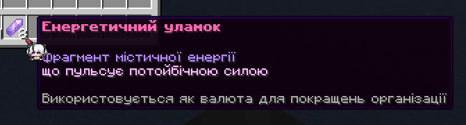
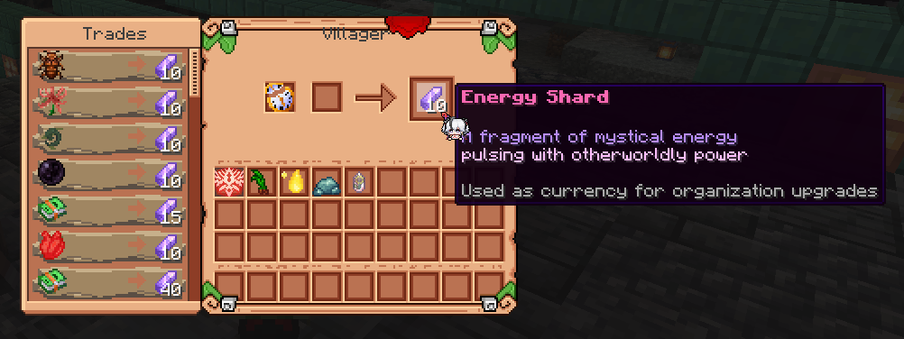

### What are Energy Shards?

Energy Shards are a new currency that looks like this ^

### What are they needed for?

This new currency is needed for many things, such as:
- Your [Secret Order](/guides/orders/)'s treasury: levels, upgrades, lair projects and commissions
- Patron offerings and the weekly Tide pool (below)
- Weakening the entrances to dungeons (rifts)
- Trading with Wild Beyonders, alongside Money
- Time-limited seasonal events, etc.

### Patron offerings

Anyone, in an order or not, can offer shards with `/patron offer <amount|all>`. The shards are used up, and in return you earn **Patron ranks**. Rank 1 takes 100 shards, and each rank after that takes 1.5x more than the one before. Every shard counts toward your next rank.

- From rank 5, reaching a new rank is announced to the whole server.
- Each week, the 3 players who offered the most become **Patrons of the Week** until the next reset.
- `/patron` shows your rank, and `/patron top` shows the week's top givers.

Offerings also fill the weekly Tide pool (see [Secret Orders](/guides/orders/#the-tide-pool)).

### How to get them?

For this, we need professionless villagers (nitwits), who previously had no purpose. Make sure you have one and right-click him, which will open the next menu:

### What can you sell there?

Each of them can buy some things from you in exchange for an Energy Shard:

- Magical Ingredients of all Sequences
- Magical Recipes of all Sequences 

It is a good way to trade your remaining ingredients and recipes for something more useful! Especially when there is a limited time event, or you want to use them to pay other services