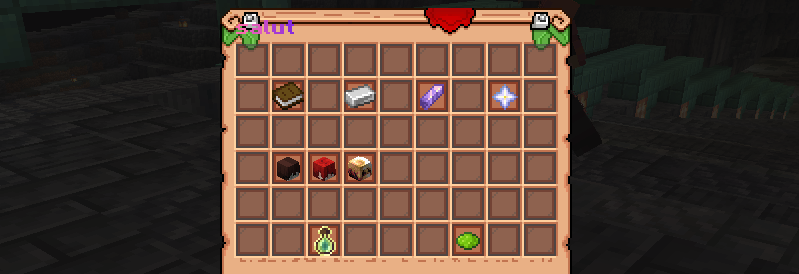
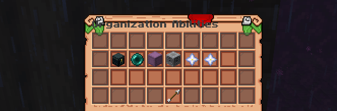
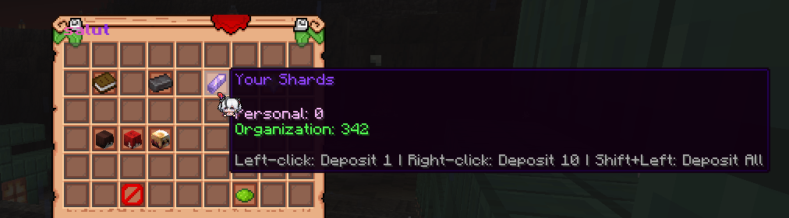

### Що таке Таємні Ордени?

Таємний Орден - це група до десяти гравців зі своєю скарбницею, здібностями, а згодом і власним приватним світом. Учасники разом наповнюють скарбницю, підвищують рівень ордену й відкривають інструменти для спільної гри: спільну схованку, місце для зустрічей, виклик, лігво.

Щоб заснувати орден, потрібне **спонсорство** (донат). Орден активний, доки активне спонсорство його лідера. Учасники нічого не платять.

Команда `/o` відкриває залу ордену. Майже все, що описано нижче, робиться звідти.

### Якщо спонсорство закінчилося

- Орден зберігає свій рівень ще **7 днів**, щоб лідер встиг поновити спонсорство.
- Після цього орден **призупиняється на рівні 0**. Прогрес не видаляється і повертається, щойно лідер поновить спонсорство.
- Поки орден призупинено, учасники можуть **забрати свої речі** зі схованки, але не можуть класти нові.
- Лідер може передати орден учаснику зі спонсорством командою `/o transfer <гравець>`. Якщо спонсорство закінчилося, а лідера немає 14 днів, передати орден може віцелідер.

## Рівні

Лідер підвищує рівень за осколки зі скарбниці ордену.

| Рівень | Назва | Ціна | Учасників | Що відкриває |
|---|---|---|---|---|
| 0 | Шепіт Туману | - | 3 | Чат ордену `/oc`, захист від магічної шкоди між учасниками, запрошення, віцелідери |
| 1 | Тінь Туману | 50 | 4 | **Схованка організації**, **Сигнал SOS**, тижневі контракти |
| 2 | Погляд Туману | 300 | 5 | **Кишеньковий вимір**, 2-га сторінка схованки |
| 3 | Обійми Туману | 1 500 | 6 | **Миттєвий виклик**, **Ритуал росту**, перше додаткове місце, 3-тя сторінка схованки |
| 4 | Серце Туману | 6 000 | 7 | **Таємне лігво**, **Бойовий клич**, **Глобальне оголошення**, решта місць і сторінок схованки |

### Покращення

Купуються один раз у Скарбниці, понад рівень. Закрите покращення показує, з якого рівня воно відкривається.

- **Місця для учасників:** 200, 400 і 800 осколків. З усіма трьома орден 4-го рівня вміщує **10 учасників**.
- **Сторінки схованки:** спочатку є одна сторінка на 27 слотів. Сторінки 2-6 коштують 300, 600, 1 200, 2 400 і 4 800 осколків.

## Здібності

| Здібність | Рівень | Хто | Що робить |
|---|---|---|---|
| Схованка організації | 1 | Усі | Спільне сховище предметів ордену |
| Сигнал SOS | 1 | Усі | `/o sos` надсилає ваші координати в чат ордену |
| Кишеньковий вимір | 2 | Запускають лідер і віцелідери, приєднуються всі | Спільний простір для зустрічей на 10 хвилин. Перезарядка 24 години |
| Миттєвий виклик | 3 | Усі | Телепортує учасника до вас. Коштує 2% шкали Відігравання. Перезарядка 30 хвилин |
| Ритуал росту | 3 | Лідер і віцелідери | **+25% до швидкості Відігравання** на 24 години. Перезарядка 7 днів |
| Таємне лігво | 4 | Створюють лідер і віцелідери, учасники входять предметом телепортації | Власний постійний світ ордену |
| Бойовий клич | 4 | Лідер і віцелідери | Швидкість II, Поспіх I і Регенерація I на 5 хвилин та повна шкала ситості для учасників у радіусі 48 блоків. Коштує 60 осколків зі скарбниці. Перезарядка 12 годин |
| Глобальне оголошення | 4 | Лідер і віцелідери | Повідомлення всім гравцям онлайн, зі звуком. Перезарядка 24 години |

**Ритуал росту** діє лише на потойбічних. Учасники, які були офлайн під час ритуалу, отримують решту з 24 годин, коли заходять у гру. Гравці, що вступили до ордену менш ніж за 24 години до ритуалу, його не отримують, тож перебігати між орденами заради бафу не вийде. Ритуал входить у загальні ліміти Відігравання на сервері: він допомагає швидше дійти до своїх лімітів, але не піднімає їх.

**Таємне лігво:** створення забирає в того, хто його створює, 50 осколків, 20 обсидіану, 5 перлин Енду і 3 алмази. Кожен предмет телепортації коштує 10 осколків, 1 перлину Енду і 2 плачучих обсидіани, крафтиться в меню лігва.

## Скарбниця

Осколки дають за продаж магічних інгредієнтів (див. [Енергетичні осколки](/uk/guides/shards/)). Покласти їх у скарбницю можна трьома способами:

- `/o deposit [кількість|all]` або картка внеску в Скарбниці.
- **Правий клік** по кнопці підтвердження в `/tradeall` відправляє оплату одразу до скарбниці.
- Виконання **тижневого контракту** (нижче).

Після кожного внеску видно наступну ціль ордену і скільки до неї лишилося. У Скарбниці також є останні десять внесків і покупок.

Забрати осколки зі скарбниці не можна. Гравцям вони повертаються лише через **доручення**: як оплата за виконану роботу.

## Тижневі контракти

З 1-го рівня орден щопонеділка отримує контракт: 2-3 магічні інгредієнти, які треба принести разом. Вищі рівні просять сильніші інгредієнти, а більші ордени - більше. Інгредієнти наступного тижня видно заздалегідь.

- Принесені предмети витрачаються.
- Коли контракт виконано, орден отримує **1,5x** від ціни в селян за все, що просили. Чверть цього отримують учасники, які приносили, пропорційно до принесеного, решта йде до скарбниці.
- Учасникам, які були офлайн, платять при наступному вході.
- Невиконаний контракт лишається відкритим ще тиждень.

Контракти також дають славу, з бонусом за 10, 25 і 50 виконаних.

## Після останнього рівня: проєкти і покращення

Орден максимального рівня все одно має на що збирати. У Скарбниці оберіть **активний проєкт**, і після кожного внеску буде видно, скільки до нього лишилося.

**Проєкти лігва** (потрібне створене Таємне лігво):

| Проєкт | Ціна | Що робить |
|---|---|---|
| Лігво: світанок, захід, ніч | по 300 | Тримає небо в лігві в цій порі доби |
| Лігво: дощ, гроза | по 300 | Тримає цю погоду в лігві |
| Розширення лігва I, II, III | 2 000 / 4 000 / 8 000 | Відсуває стіну зі 100 до 150, 200 і 250 блоків. Ваші будівлі не зачіпаються |
| Пюпітр лігва | 1 000 | Будь-який пюпітр без книги у вашому лігві відкриває схованку |
| Вогнище лігва | 800 | Лідер або віцелідер обирає, куди учасники прибувають у лігво |
| Прапор лігва | 400 | Прапор ордену висить уздовж усієї стіни лігва |

**Покращення:**

| Покращення | Ціна | Що робить |
|---|---|---|
| Сортування схованки | 200 | Кнопка, що об'єднує стаки і сортує схованку |
| Журнал схованки | 300 | Хто що поклав і забрав за останні 7 днів (лідер і віцелідери) |
| Довгі сесії виміру | 600 | Сесії Кишенькового виміру тривають 15 хвилин |
| Золота, багряна і туманна рамки | по 75 | Рамки для Глобального оголошення |

### Обряд Спадщини

Коли все інше куплено, орден максимального рівня може виконувати **Обряд Спадщини** у Скарбниці знову і знову. Кожен обряд додає зірку до назви ордену в `/oc`, `/o top` і в залі. Перший коштує 3 000 осколків, кожен наступний - у 1,5 раза більше за попередній.

### Дрібні зручності

Дрібниці, які скарбниця може оплатити, коли відповідну здібність відкрито: **Shift-клік** по кнопці, до якої вони належать. Кожна має своє обмеження, тож повторювати їх без кінця не вийде. Платить лідер або віцелідер зі скарбниці, крім скидання виклику: його ви оплачуєте своїми осколками.

| Що | Де | Ціна | Обмеження |
|---|---|---|---|
| Ще 10 хвилин у Кишеньковому вимірі | Кишеньковий вимір, кнопка запуску | 30 | раз за сесію |
| Відкрити Кишеньковий вимір знову до кінця перезарядки | Кишеньковий вимір, кнопка запуску | 150 | раз на тиждень |
| Скинути свою перезарядку Миттєвого виклику | Здібності, Миттєвий виклик | 25 ваших осколків | раз на день |
| Предмети телепортації в лігво без матеріалів | Таємне лігво, кнопка крафту | по 10 | без обмежень |
| Перейменувати орден раніше ніж за 7 днів | `/o rename`, потім `/o confirm` | 100 | раз на тиждень |
| Замінити один інгредієнт контракту цього тижня (лише якщо його ще ніхто не приносив) | Тижневий контракт | 50 | раз на тиждень |
| Змінити колір тегу в чаті (перший вибір безкоштовний) | `/o settings tag`, потім `/o confirm` | 50 | без обмежень |
| **Бенкет ордену:** Насичення і Регенерація на 10 хвилин для учасників у радіусі 30 блоків. Лише у вашому лігві | Таємне лігво, картка стану | 40 | раз на день |

## Доручення

Лідер або віцелідер може платити гравцям за роботу зі скарбниці. Візьміть предмет у руку і введіть:

`/o commission <кількість> <нагорода> [public|members]`

- Приймаються лише звичайні предмети: без назв, зачарувань і пошкоджень.
- **Публічні** доручення (за замовчуванням) видно всім на `/commissions`, тож їх можуть виконати й гравці не з ордену. `members` лишає доручення всередині ордену.
- Принесені предмети йдуть у схованку. Кожна здача одразу оплачує свою частку нагороди, а 10% від кожної виплати згорає як податок.
- Обмеження: 5 відкритих доручень, 300 осколків на учасника і 1 000 на орден за тиждень. Доручення зникає через 7 днів.

## Слава

Слава зростає від того, що орден робить **разом**: підвищення рівня, покращення, проєкти, сесії Кишенькового виміру з 3 і більше учасниками, контракти, доручення, обряди Спадщини. Самими осколками її не купиш, і вона ніколи не зменшується.

| Ступінь | Слава | Нагорода |
|---|---|---|
| Відомий | 50 | Тег ордену перед повідомленнями в `/oc`, у кольорі на ваш вибір |
| Шанований | 150 | Титул «з ордену &lt;Назва&gt;» для учасників, більше кольорів тегу, Прапор лігва за пів ціни |
| Славетний | 400 | Двоколірний градієнтний тег, ще два звуки Глобального оголошення |
| Легендарний | 1 000 | Золота назва і зірка в `/o top` |

- `/o top` показує найславетніші ордени. Орден з'являється там, лише якщо ввімкне це командою `/o settings public on`, бо за замовчуванням ордени таємні.
- `/o settings tag <колір> [колір]` задає тег у чаті, а `/o settings tag off` ховає його.

## Скарбниця Припливу

Щотижня весь сервер наповнює одну спільну скарбницю. Ордени вносять зі своєї скарбниці командою `/o tidepool <кількість|all>`, а будь-який гравець може додати через пожертви `/patron`. Якщо скарбниця досягне цілі, орден, що вніс найбільше, **обирає день Припливу** на наступний тиждень і посідає Престол Припливу на спавні. Той самий орден не може перемогти два тижні поспіль. `/tidepool` показує стан скарбниці.

## Команди

| Команда | Що робить |
|---|---|
| `/o` | Відкрити залу ордену |
| `/o create <назва>` | Заснувати орден (потрібне спонсорство) |
| `/o invite <гравець>`, `/o kick <гравець>` | Запросити або вигнати учасника |
| `/o vice set/remove <гравець>` | Призначити або зняти віцелідера |
| `/o rename <назва>` | Перейменувати орден (раз на 7 днів) |
| `/o transfer <гравець>` | Передати лідерство учаснику зі спонсорством |
| `/o leave`, `/o disband` | Вийти або розпустити орден (підтвердження `/o confirm`) |
| `/o deposit [кількість\|all]` | Покласти осколки до скарбниці |
| `/o sos` | Надіслати свої координати в чат ордену |
| `/oc <повідомлення>` | Чат ордену |
| `/o commission <кількість> <нагорода> [public\|members]` | Опублікувати доручення |
| `/commissions` | Публічна дошка доручень |
| `/o top`, `/o settings tag\|public` | Список слави і налаштування ордену |
| `/o tidepool <кількість\|all>`, `/tidepool` | Тижнева Скарбниця Припливу |
| `/patron` | Пожертви Покровителя (див. [Енергетичні осколки](/uk/guides/shards/)) |
