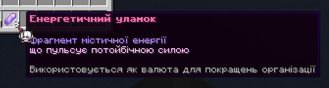
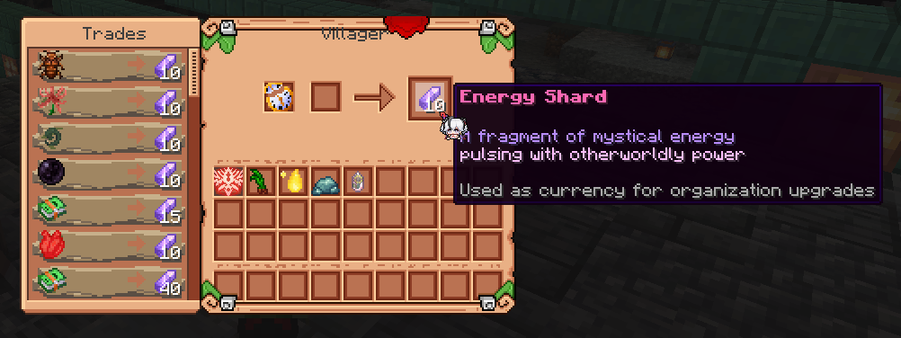

### Що таке Енергетичні осколки?

Енергетичні осколки - це нова валюта, яка виглядає так ^

### Для чого вони потрібні?

Ця нова валюта потрібна для багатьох речей, таких як:
- Скарбниця вашого [Таємного Ордену](/uk/guides/orders/): рівні, покращення, проєкти лігва і доручення.
- Пожертви Покровителя і тижнева Скарбниця Припливу (нижче).
- Послаблення входів до підземель (розломів).
- Торгівля з Дикими Потойбічними, разом із грошима.
- Сезонні події з обмеженим часом тощо.

### Пожертви Покровителя

Будь-хто, з орденом чи без, може пожертвувати осколки командою `/patron offer <кількість|all>`. Осколки витрачаються, а натомість ви отримуєте **ранги Покровителя**. Перший ранг коштує 100 осколків, кожен наступний - у 1,5 раза більше за попередній. Кожен осколок іде в рахунок наступного рангу.

- Починаючи з 5-го рангу, про новий ранг оголошують на весь сервер.
- Щотижня 3 гравці, що пожертвували найбільше, стають **Покровителями тижня** до наступного скидання.
- `/patron` показує ваш ранг, а `/patron top` - найщедріших гравців тижня.

Пожертви також наповнюють тижневу Скарбницю Припливу (див. [Таємні Ордени](/uk/guides/orders/#скарбниця-припливу)).

### Як їх отримати?

Для цього нам потрібні селяни без професії (нітвіти/дурні), які раніше не мали жодної мети. Переконайтеся, що у вас є такий, і натисніть на нього ПКМ, що відкриє наступне меню:

### Що там можна продати?

Кожен із них може купити у вас деякі речі в обмін на Енергетичний осколок:

- Магічні інгредієнти всіх Послідовностей.
- Магічні рецепти всіх Послідовностей.

Це гарний спосіб обміняти залишки інгредієнтів і рецептів на щось корисніше! Особливо, коли триває подія з обмеженим часом або коли ви хочете використати їх для оплати інших послуг.
