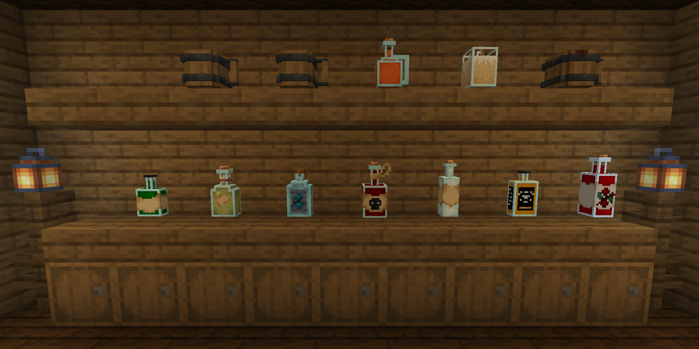
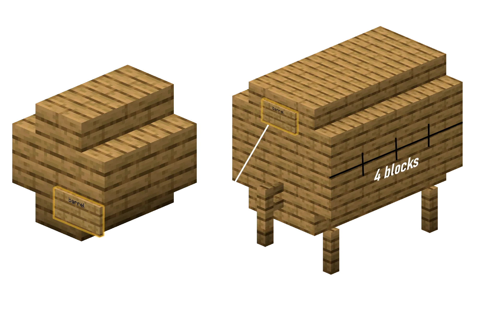

## 酿酒坊是什么？

**酿酒坊**让你酿造酒、咖啡，以及提供饱和效果、可以代替固体食物的**营养饮品**。这些是日常饮品，不是非凡魔药，魔药见[炼制与魔药](/zh-cn/magic/brewing/)。

大多数饮品都有自己的 3D 瓶子模型。

## 酿造是怎样进行的？

一瓶完美的 5 星饮品最多需要四个步骤：

1. **发酵**，把材料放进加热的炼药锅里煮一段规定的时间，然后用玻璃瓶装起来。
2. **蒸馏**，在酿造台里加入荧石粉蒸馏混合物。只有高度烈酒需要这一步。
3. **陈酿**，把瓶子放在木桶里陈放好几个 Minecraft“年”。
4. **封存**，在饮品封存台里封存成品，让它的品质和年份永久固定。

## 煮沸

每种饮品都从一口沸腾的炼药锅开始。

1. 把一口装满水的炼药锅放在热源上，例如营火、火、岩浆块或熔岩。
2. 拿着配方里的材料右键点击炼药锅。
3. 拿着**时钟**右键点击沸腾的炼药锅，可以看到材料已经煮了多久。气泡粒子的颜色也会随时间变化，所以不用时钟也能掌握配方的时间。
4. 煮好后，拿着空的**玻璃瓶**右键点击炼药锅，装起基础混合物。

## 蒸馏

烈酒需要蒸馏。

1. 把煮好的瓶子放进**酿造台**下面的三个格子里。
2. 在最上面的格子里放**荧石粉**。蒸馏时它会被消耗。
3. 在酿造台里每过一遍，就算一次“蒸馏”。蒸馏过度会降低品质，甚至毁掉饮品。

## 木桶陈酿

陈酿会提升品质，并根据木桶的木材改变饮品的描述和风味。需要云杉木桶的配方，只有在完全用云杉建造的木桶里才能达到最高品质。

饮品在登记过的木桶里会自己陈酿。每个 Minecraft“年”相当于**现实中的 20 分钟**。

## 木桶结构

你可以用 13 种材料中的任意一种建造两种大小的木桶，分别是白桦、橡木、丛林、云杉、金合欢、深色橡木、绯红、诡异、红树、樱花、竹、苍白橡木和切制铜块。

普通的 Minecraft **木桶**方块也能陈酿饮品。它最多装 6 瓶，算作橡木。

### 小木桶（可装 9 瓶）

1. 在地面上用 4 个你选择的木楼梯摆成 2x2 的正方形，楼梯朝内。
2. 在它们正上方再放 4 个楼梯，同样朝内，组成一个中空的 2x2x2 方块。
3. 在正面放一块告示牌，在第一行写上 `barrel`。
4. 右键点击告示牌进行登记。你应该会在聊天栏看到 `Barrel created!`。

### 大木桶（可装 27 瓶）

1. 在地面上放 4 根栅栏，作为一个 3x3x4 圆筒的支脚。
2. 建造一个横放的圆筒，宽 3 格，长 4 格：
    - **底层。**左边 4 个楼梯，右边 4 个楼梯，中间一排 4 块木板。
    - **中层。**左边 4 块木板，右边 4 块木板，正面中间 1 块木板，背面中间 1 块木板。中心保持中空。
    - **顶层。**左边 4 个楼梯，右边 4 个楼梯，中间一排 4 块木板。
3. 在正面底部中间的木板上放一根栅栏。这就是龙头。
4. 在龙头正上方的中间木板上放一块告示牌，在第一行写上 `barrel`。
5. 右键点击告示牌进行登记。

## 封存台

没封存的饮品放在物品栏或储物里时会一直变化。封存会锁定饮品的品质并让它停止陈酿，所以在出售或储存之前，先把成品封存起来。

封存台放下来是一个**烟熏炉**方块，但普通的烟熏炉无法封存饮品。在工作台的最上面一行放 **2 个玻璃瓶**，下面放 **4 块木板**来制作它。把成品饮品放进封存台，点击即可封存。

## 醉酒与宿醉机制

酒精饮品会提高你的醉酒百分比，带来下面这些效果：

1. **踉跄。**你会朝随机的方向踉跄。
2. **醉话。**你的聊天消息会变得含糊不清。S 会变成 `sh`，单词会被打乱，你还会随机打嗝（`*hic*`）或打饱嗝（`*burp*`）。
3. **醉酒告示牌。**你在告示牌上写的字会变得乱七八糟。
4. **呕吐。**如果酒精含量太高，你会吐出来，掉出一些你捡不起来的物品，例如 `SOUL_SAND`、`ROTTEN_FLESH` 和 `BEETROOT`。
5. **醒来。**如果你醉得很厉害时下线，回来时可能会在管理团队设置的某个醒来地点“醒来”。醉得极其厉害时，你可能还要试好几次才能登录。

宿醉在你下线后会被记住 **7 天**，所以下线并不能治好它。

### 醒酒

下面这些物品可以降低醉酒程度或治好宿醉：

| 物品 | 降低的酒精值 |
|:---|:---|
| 金苹果 | **10** |
| 面包 | **4** |
| 蜂蜜瓶 | **3** |
| 牛奶桶 | **2** |
| 水桶 | **2** |
| 胡萝卜 | **2** |

## 配方书

严格按照配方操作，就能得到 **5 星品质**的饮品。**陈酿**一栏里的 "-" 表示饮品装瓶后马上就能喝。

如果饮品毁了，把鼠标悬停在它上面。提示框会给出类似 `Too much time in the oven...` 或 `One of the ingredients doesn't taste good...` 的提示，帮你修正配方。

### 饱和与代替食物的饮品

这些饮品会给你**饱和**效果，所以你可以不吃固体食物。

| 名称 | 材料 | 煮沸时间 | 蒸馏次数 | 陈酿 | 药水效果 | 描述 |
|:---|:---|:---:|:---:|:---:|:---|:---|
| **矮人黑啤**（Dwarven Stout） | 8 小麦，4 甜浆果，1 煤炭 | 10 分钟 | 0 | 橡木（6 年） | 饱和 I-II 抗性提升 I（1-2 分钟） 缓慢 I（15 秒） | 一种浓重的烟熏黑啤，喝起来有泥土和炉火的味道。非常顶饱。 |
| **液体面包**（Liquid Bread） | 4 面包，4 小麦，2 糖 | 6 分钟 | 0 | 白桦（2 年） | 饱和 II-III 生命恢复 I（10-30 秒） | 终极生存饮品，斋戒的修士最爱喝。名副其实的液体面包。 |
| **精灵蜂蜜酒**（Elven Honeymead） | 8 甘蔗，2 蜂蜜瓶，4 西瓜片 | 5 分钟 | 0 | 金合欢（15 年） | 饱和 II 迅捷 I（1-2 分钟） 生命恢复 I-II（10-20 秒） | 甜得像液态的阳光。能让旅人在荒野中撑上好几天。 |
| **黄金盛宴灵药**（Golden Feast Elixir） | 2 金胡萝卜，1 荧石粉，6 甜浆果，4 甘蔗 | 12 分钟 | 1 | 云杉（10 年） | 饱和 IV-V 发光 I（60 秒） 迅捷 I-II（30-60 秒） | 一种闪闪发光的神奇金色浓汤，连极度的饥饿都能治好。 |

### 混乱又搞笑的饮品

| 名称 | 材料 | 煮沸时间 | 蒸馏次数 | 陈酿 | 药水效果 | 描述 |
|:---|:---|:---:|:---:|:---:|:---|:---|
| **侏儒晕乎果汁**（Gnomish Giddy Juice） | 2 红色蘑菇，2 棕色蘑菇，4 发光浆果，4 糖 | 4 分钟 | 2 | 橡木（1 年） | 饱和 I 反胃 I-II（20-40 秒） 跳跃提升 II-IV（30-60 秒） 发光 I（30 秒） | 一种冒着泡、闪着光的粉色调制饮料。让你跳得很高，开心得晕乎乎的！ |
| **海盗格罗格酒**（Pirate's Grog） | 6 海带，10 甘蔗，6 西瓜片 | 8 分钟 | 2 | 深色橡木（5 年） | 饱和 I-II 水下呼吸 I（1-2 分钟） 村庄英雄 I（30 秒） | 又辣又咸的格罗格酒，能赶走坏血病，让你感觉自己是海盗王。 |
| **发光蘑菇伏特加**（Glowing Mushroom Vodka） | 10 马铃薯，3 红色蘑菇，3 棕色蘑菇 | 18 分钟 | 5 | - | 虚弱（80 秒） 反胃（27 秒） 夜视（50-80 秒） 失明（2-12 秒） 缓慢（3-10 秒） | 一种迷幻的饮品。真的会在黑暗中发光，还会扭曲现实。 |

### 经典啤酒与麦芽酒

| 名称 | 材料 | 煮沸时间 | 蒸馏次数 | 陈酿 | 背景故事 / 描述 |
|:---|:---|:---:|:---:|:---:|:---|
| **小麦啤酒**（Wheatbeer） | 3 小麦 | 8 分钟 | 0 | 白桦（2 年） | 清爽又爽口。 |
| **啤酒**（Beer） | 6 小麦 | 8 分钟 | 0 | 任意（3 年） | 传统的酒馆麦芽酒。 |
| **黑啤酒**（Darkbeer） | 6 小麦 | 8 分钟 | 0 | 深色橡木（8 年） | 烘烤过的浓郁麦芽风味。 |

### 葡萄酒、蜂蜜酒与苹果酒

| 名称 | 材料 | 煮沸时间 | 蒸馏次数 | 陈酿 | 药水效果 | 描述 |
|:---|:---|:---:|:---:|:---:|:---|:---|
| **红葡萄酒**（Red Wine） | 5 甜浆果 | 5 分钟 | 0 | 任意（20 年） | 没有 | 酒体饱满，需要在木桶里长时间陈酿。 |
| **蜂蜜酒**（Mead） | 6 甘蔗 | 3 分钟 | 0 | 橡木（4 年） | 没有 | 经典的蜂蜜风味酒。 |
| **苹果蜂蜜酒**（Apple Mead） | 6 甘蔗，2 苹果 | 4 分钟 | 0 | 橡木（4 年） | 水下呼吸（150 秒） | 香甜的苹果蜂蜜酒，能帮你在水下呼吸。 |
| **苹果酒**（Apple Cider） | 14 苹果 | 7 分钟 | 0 | 任意（3 年） | 没有 | 香甜清爽的苹果酒。 |

### 烈酒

需要蒸馏的高度酒。在老汤姆金酒里，“蓝色花朵”指的是矢车菊或兰花。

| 名称 | 材料 | 煮沸时间 | 蒸馏次数 | 陈酿 | 药水效果 | 描述 |
|:---|:---|:---:|:---:|:---:|:---|:---|
| **卡尔瓦多斯（苹果烈酒）**（Calvados） | 12 苹果 | 16 分钟 | 3 | 金合欢（6 年） | 没有 | 最差时酸得像酸液，最好时是一款上等白兰地。 |
| **苏格兰威士忌**（Scotch Whiskey） | 10 小麦 | 10 分钟 | 2 | 云杉（18 年） | 没有 | 一款带有浓郁木香的单一麦芽威士忌。 |
| **金朗姆酒**（Golden Rum） | 18 甘蔗 | 6 分钟 | 2 | 橡木（14 年） | 抗火（20-100 秒） 中毒（0-30 秒） | 温暖的香料金朗姆酒，能提供短暂的防火保护。 |
| **俄罗斯伏特加**（Russian Vodka） | 10 马铃薯 | 15 分钟 | 3 | - | 虚弱（15 秒） 中毒（10 秒） | 一种辛辣的马铃薯烈酒。品质差的时候几乎没法喝。 |
| **老汤姆金酒**（Old Tom Gin） | 9 小麦，6 蓝色花朵，1 苹果 | 6 分钟 | 2 | - | 没有 | 带有杜松子的细腻风味。 |
| **陈年龙舌兰**（Tequila Anejo） | 8 仙人掌 | 15 分钟 | 2 | 白桦（12 年） | 没有 | 沙漠之魂，在白桦木中陈酿。 |
| **烈性苦艾酒**（Strong Absinthe） | 15 草 | 3 分钟 | 6 | - | 中毒（15-25 秒） | 高度草本烈酒。毒性很强，但劲也很大。 |
| **绿色苦艾酒**（Green Absinthe） | 17 草，2 毒马铃薯 | 5 分钟 | 6 | - | 中毒（25-40 秒） 瞬间伤害 II 夜视（40-60 秒） | 一种看起来就有毒的青绿色烈酒。会扭曲视线。 |
| **黄金伏特加**（Golden Vodka） | 10 马铃薯，2 金粒 | 18 分钟 | 3 | - | 虚弱（28 秒） 中毒（4 秒） | 闪闪发光的金色伏特加。 |
| **烈焰威士忌**（Blazing Whiskey） | 10 小麦，2 烈焰粉 | 12 分钟 | 3 | 云杉（18 年） | 没有 | 喝下去时嘴里有一种灼烧感！ |

### 特色饮品与醒酒饮品

这些饮品大多不含酒精，或者能帮你醒酒。蛋黄酒是例外，它含有酒精。

| 名称 | 材料 | 煮沸时间 | 蒸馏次数 | 陈酿 | 药水效果 | 描述 |
|:---|:---|:---:|:---:|:---:|:---|:---|
| **马铃薯汤**（Potato Soup） | 5 马铃薯，3 草 | 3 分钟 | 0 | - | 瞬间治疗（品质越高越强） | 热乎乎的营养汤，能恢复生命值。 |
| **浓咖啡**（Strong Coffee） | 12 可可豆，2 牛奶桶 | 2 分钟 | 0 | - | 迅捷（30-140 秒） 生命恢复（2-5 秒） 酒精 -6% | 清醒头脑、快速醒酒的最佳选择。 |
| **蛋黄酒（蛋酒）**（Advocaat） | 5 鸡蛋，2 糖，1 牛奶桶 | 2 分钟 | 0 | 任意（3 年） | 没有 | 用生鸡蛋做的奶油蛋黄酒。含酒精。 |
| **热巧克力**（Hot Chocolate） | 3 曲奇 | 2 分钟 | 0 | - | 急迫（40 秒） | 热乎乎的甜可可，给你挖矿的力气。 |
| **冰咖啡**（Iced Coffee） | 8 曲奇，4 雪球，1 牛奶桶 | 1 分钟 | 0 | - | 迅捷（10 秒） 生命恢复（30 秒） 酒精 -8% | 快速醒酒的最佳饮品。冰凉又香甜。 |
