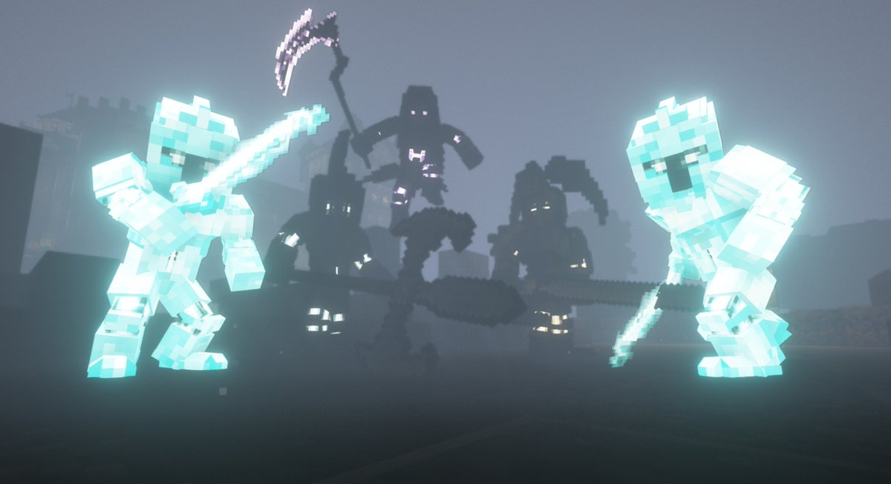
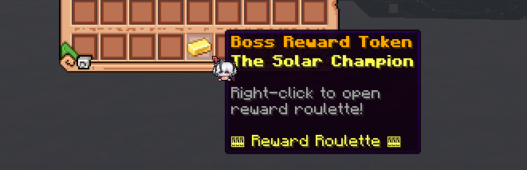
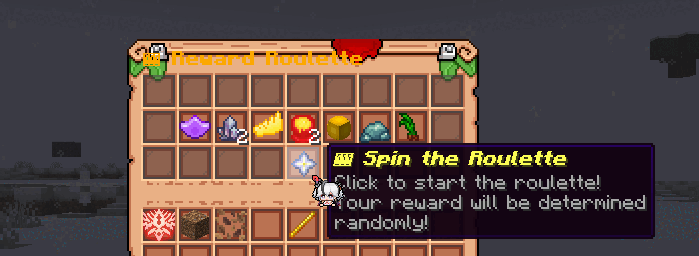
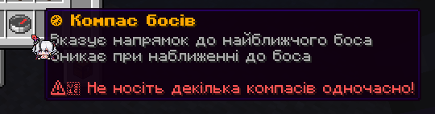

裂隙首领（以前叫守护者）是世界首领，22 条途径各有一位，按固定的每周时间表出现在主世界。每位帮忙击败首领的玩家，都有机会获得这条途径的配方、非凡特性和材料。

## 裂隙首领什么时候生成？

每位首领都有自己每周的时间段，通常一周两次。首领出现前 **30、15、5 和 1 分钟**，全服都会在聊天栏收到警告。

| 日期 | 首领（服务器时间） |
|---|---|
| 星期一 | 不眠者 10:00，刺客 16:00，耕种者 18:00，律师 20:00，学徒 22:00，窥秘人 22:00 |
| 星期二 | 偷盗者 10:00，占卜家 16:00，药师 22:00，怪物 22:00 |
| 星期三 | 秘祈人 10:00，阅读者 10:00，囚犯 14:00，收尸人 14:00，通识者 16:00，猎人 22:00，歌颂者 23:00 |
| 星期四 | 仲裁人 10:00，水手 16:00，耕种者 18:00，战士 18:00，罪犯 22:00，窥秘人 22:00，观众 22:00 |
| 星期五 | 不眠者 10:00，律师 16:00，刺客 16:00，学徒 22:00，药师 22:00 |
| 星期六 | 偷盗者 10:00，囚犯 14:00，占卜家 14:00，阅读者 14:00，怪物 18:00，战士 20:00，秘祈人 22:00 |
| 星期日 | 通识者 10:00，猎人 14:00，仲裁人 16:00，收尸人 18:00，歌颂者 19:00，罪犯 22:00，水手 22:00 |

管理团队可以更改时间表，所以请以聊天栏的警告为准，而不是这张表。

### 它们会出现在哪里？

在主世界的一个随机地点，距离中心每个方向最远 12,000 格。**首领指南针**可以带你找到它。

## 哪位首领属于哪条途径？

| 途径 | 首领 | 狂怒于 | 仅限魔法于 |
|---|---|---|---|
| 罪犯途径 | 深渊恐魔（The Abyssal Horror） | 35% | 20% |
| 律师途径 | 帝国君主（The Imperial Sovereign） | 35% | 20% |
| 囚犯途径 | 被缚吞噬者（The Chained Devourer） | 30% | 20% |
| 不眠者途径 | 暗影先驱（The Shadow Harbinger） | 30% | 20% |
| 收尸人途径 | 永恒死神（The Eternal Reaper） | 30% | 20% |
| 刺客途径 | 绯红魔女（The Crimson Demoness） | 35% | 25% |
| 学徒途径 | 维度守门人（The Dimensional Gatekeeper） | 35% | 20% |
| 偷盗者途径 | 悖论实体（The Paradox Entity） | 35% | 20% |
| 占卜家途径 | 疯狂小丑（The Jester of Madness） | 50% | 20% |
| 秘祈人途径 | 悬吊之魂（The Suspended Soul） | 30% | 25% |
| 窥秘人途径 | 孤独贤者（The Solitary Sage） | 25% | 20% |
| 仲裁人途径 | 神圣仲裁者（The Divine Arbitrator） | 30% | 20% |
| 药师途径 | 月之女皇（The Lunar Empress） | 40% | 25% |
| 耕种者途径 | 原初之母（The Primal Mother） | 30% | 20% |
| 通识者途径 | 巅峰工匠（The Apex Crafter） | 30% | 20% |
| 猎人途径 | 火焰祭司（The Flame Cleric） | 40% | 20% |
| 歌颂者途径 | 太阳勇士（The Solar Champion） | 25% | 15% |
| 战士途径 | 巨像守护者（The Colossal Guardian） | 40% | 15% |
| 水手途径 | 风暴暴君（The Storm Tyrant） | 35% | 15% |
| 观众途径 | 心灵先知（The Mind Seer） | 40% | 15% |
| 怪物途径 | 命运编织者（The Fate Weaver） | 30% | 20% |
| 阅读者途径 | 高塔建筑师（The Tower Architect） | 30% | 25% |

## 战斗是怎样进行的？

首领战分为三个阶段：

1. **普通。**首领以全部实力战斗。
2. **狂怒。**当它的生命值降到狂怒阈值时，首领会**回血**到生命值的 60% 到 80%，并召唤 **2 名野生非凡者护卫**。如果狂怒阶段拖了 10 分钟，它造成的伤害会变成 x1.2 到 x1.5。
3. **最终阶段（仅限魔法）。**在生命值 15% 到 25% 时，首领会**免疫物理伤害**，只有法术能伤到它。它还会再召唤 **3 名护卫**。

:::caution[带上非凡者]
没有施法者的队伍无法打完首领。它召唤的护卫会按战斗中最强的非凡者来缩放。
:::

### 首领战难在哪里？

| 规则 | 说明 |
|---|---|
| 强度缩放 | 首领按附近玩家的**非凡总战力**缩放，而不是按人数。每位玩家的战力是序列9 = 1，8 = 1.6，7 = 2.6，6 = 4.2，5 = 6.8，4 = 11，3 = 18，2 = 29，1 = 47。普通人算 0.35 |
| 同途径抗性 | 首领受到它自己途径能力的伤害只有 **35%** |
| 每次命中的伤害上限 | 一次命中最多只能打掉首领 **4%** 的生命值 |
| 首领的攻击 | 首领一次攻击最多造成 60 点伤害 |
| 灵性流失 | 在 40 格以内，你**每 8 秒失去 6% 的灵性**（后面的阶段更多） |
| 疯狂值 | 在 40 格以内，你每 15 秒增加一次疯狂值（后面的阶段更多，序列4及更强的非凡者只增加一半） |
| 不能飞行 | 在首领附近 10 秒后，飞行就会失效 |

## 击败首领能得到什么？

做出贡献的玩家会得到一枚或多枚**首领奖励代币**，以首领的名字命名（例如 "Boss Reward Token: The Solar Champion"）。你在战斗中的贡献越大，得到的代币越多。代币可以交易或保存。

右键点击代币，打开**奖励轮盘**并转动它。奖池里有这条途径从序列9到序列1的配方、非凡特性和材料。较弱的物品比强的物品常见得多。

击杀首领也会通过 World 来源给你扮演。

## 怎样找到首领？

**首领指南针**指向最近的活跃首领。

在首领出现期间右键点击它来开启。它会工作 **30 分钟**，显示方向和大致距离，你靠近后它会消失。一次只带一个。战斗通行证的奖励里有首领指南针。

