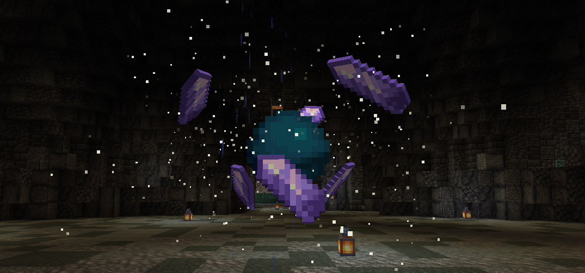
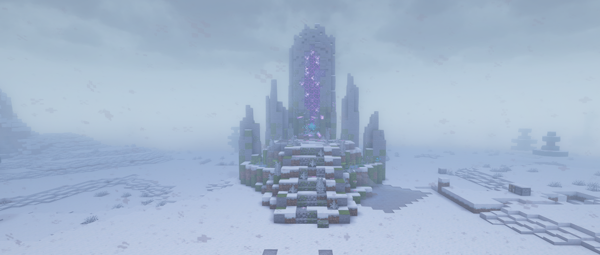

import {Figure} from '~/components/mdx';
import subspaceMenu from '~/assets/dungeons/subspace-menu.webp';
import chooseDifficulty from '~/assets/dungeons/choose-difficulty.webp';
import cardShop from '~/assets/dungeons/helping-card-shop.webp';

地牢是独立的副本世界，队伍通过主世界里的一道**裂隙**进入。你要带着职业装备一路打过各个房间，直到最终首领，然后带着战利品、援助卡和扮演离开。每位玩家每次进入只有**一条命**。

## 有哪些地牢？

| 地牢 | 队伍人数 | 地牢战力 | 场景 |
|---|---|---|---|
| **战栗空洞**（The Shivering Hollow） | 4 | 0 | 一个冰封的地下洞穴 |
| **余烬复燃**（Embers Resurgence） | 5 | 100 | 一座火山要塞 |
| **林冠之根**（Root of the Canopy） | 4 | 240 | 一座由巨大树根构成的迷宫 |
| **尘埃城塞**（The Dust Citadel） | 3 | 450 | 一座被掩埋的沙漠堡垒 |

战栗空洞和余烬复燃各有两个入口，其他地牢各有一个。还不是非凡者的玩家也可以进入战栗空洞。

## 怎样找到地牢？

输入 `/subspace`。菜单会列出每个地牢、每个入口裂隙的坐标、你和地牢的战力对比，以及你的冷却时间和今天剩余的援助卡次数。

<Figure src={subspaceMenu} alt="Ventures to the Subspace 菜单，尘埃城塞的提示框显示战力等级 450 和一个入口" caption="/subspace 菜单。把鼠标悬停在地牢上，可以看到它的战力等级和入口。" contain />

裂隙是一根闪烁的粒子柱。和你的队伍一起走进去就能开始。

## 怎样进入地牢？

1. 用 `/party` **组建队伍**并邀请你的朋友。`/ready` 和 `/leave` 用来管理排队。
2. **前往裂隙**并走进去。
3. 在 "Choose Difficulty" 界面**选择难度**。
4. 地牢加载后**选择职业**。如果你没有及时选择，系统会给你分配一个。

<Figure src={chooseDifficulty} alt="Choose Difficulty 界面，普通难度的提示框显示需要 450 战力，造成和受到的伤害都是 x1" caption="Choose Difficulty。把鼠标悬停在某个档位上，可以看到它需要的战力。" contain />

如果你的队伍人数少于地牢的队伍人数，会询问你是否 **Enter Understaffed?** 只有你的战力比地牢战力高出不超过 150 时才允许这样做。战力过高的玩家必须带满一整队。

:::note[空着手进去]
如果队伍里有人携带了某些资源，地牢不会开始（"Someone in the party is carrying resources!"）。把贵重物品留在家里。
:::

## 什么是地牢战力？

你的战力来自你的序列：

| 序列 | 9 | 8 | 7 | 6 | 5 |
|---|---|---|---|---|---|
| 战力 | 30 | 60 | 100 | 150 | 220 |

| 序列 | 4 | 3 | 2 | 1 | 0 |
|---|---|---|---|---|---|
| 战力 | 320 | 450 | 600 | 800 | 999 |

只有你的战力比地牢战力**最多低 29**，你才能进入。战力不足也会削弱你。在低于 10、20 和 29 时分阶段生效，你造成的伤害会下降（最低到 x0.4），受到的伤害会上升（最高到 x1.6）。战力达到或超过地牢战力时没有惩罚。

## 难度档位有哪些？

每个地牢都有四个档位。越难的档位给的扮演越多，援助卡也越好。

| 档位 | 需要的战力 | 你造成的伤害 | 你受到的伤害 |
|---|---|---|---|
| 普通（Normal） | 地牢战力 | x1.0 | x1.0 |
| 进阶（Advanced） | 地牢战力 + 50 | x0.7 | x1.5 |
| 大师（Master） | 地牢战力 + 150 | x0.5 | x1.8 |
| 宗师（Grandmaster） | 450（序列3）或以上 | x0.3 | x2.5 |

在大师和宗师档位，你总会被当作战力稍有不足来对待。

## 我多久能打一次地牢？

| 类型 | 频率 | 你能得到什么 |
|---|---|---|
| **真正的战利品局** | 每个地牢每 **72 小时**一次 | 箱子和首领的战利品 |
| **援助卡局** | 冷却期间每个地牢**每天最多 2 次** | 箱子被封住。打完后你会得到 **1 张援助卡** |

大部分战利品会以**碎片**（"Shard of ..."）的形式掉落。手持足够数量的碎片右键点击，就能把它们合成真正的物品。序列9的配方或魔药需要 2 块碎片，越强的物品需要越多，序列0最多需要 9 块。

### 地牢钥匙是什么？

| 钥匙 | 效果 |
|---|---|
| **简易钥匙** | 重置你自己在某个地牢的战利品冷却 |
| **高级钥匙** | 重置你队伍的冷却（最多到地牢的队伍人数），让这一局变成真正的战利品局，并让援助卡翻倍 |

右键点击钥匙，然后选择地牢。钥匙来自战斗通行证和商店。

## 援助卡有什么用？

每张**援助卡**都属于一个地牢和一个档位。右键点击它，打开**援助卡商店**，用卡片兑换奖励。例如，余烬复燃的大师档位：

<Figure src={cardShop} alt="援助卡商店，余烬复燃大师档位的材料兑换代币提示框，花费 8 张援助卡" caption="援助卡商店。把鼠标悬停在奖励上，可以看到它需要多少张卡。" contain />

| 奖励 | 卡片 |
|---|---|
| 材料代币 | 8 |
| 配方代币（序列6） | 12 |
| 魔药代币（序列6） | 16 |
| 扮演之瓶（10,000） | 20 |
| 抗失控护符 | 24 |
| 仪式之书（一阶） | 32 |

林冠之根和尘埃城塞的商店奖励以战利品碎片的形式发放，而不是完整的物品。余烬复燃和林冠之根的宗师商店还出售[途径转换信物](/zh-cn/guides/special-items/)。

## 地牢能给多少扮演？

打完地牢会通过 World 来源给你扮演。越难的档位给得越多（进阶 x1.25，大师 x1.5，宗师 x2）。所有地牢加起来，地牢扮演**每天最多 600**，在 UTC 午夜重置。

## 我应该选哪个职业？

| 职业 | 魔法伤害 | 物理伤害 | 说明 |
|---|---|---|---|
| **坦克** | x0.3 | x0.6 | 防御高，会把怪物吸引到自己身上 |
| **法师** | x2.2 | x0.15 | 法术打得很痛，空手毫无用处 |
| **战士** | x0.7 | x1.8 | 近战强，但死得快 |
| **弓箭手** | x0.8 | x0.7 | 弓和弩造成 x2.2 伤害 |
| **辅助** | x1.0 | x0.8 | 魔法防御强，可以使用全部增益 |

一支均衡的队伍有一名坦克来拉住怪物，有适合你们非凡者的输出，有条件的话再加一名辅助。

### 哪些能力在地牢里被禁用？

下面这些能力在地牢里无效，分别是梦魇、梦魇世界、旅行家之门、放逐、丝线之手、丝线、纸人替身、口袋空间、神圣装备、开锁、怨魂化、木偶化和木偶附身。有些职业还会禁用某些能力（"Your class cannot use this ability in the dungeon!"）。

## 关闭的裂隙是怎么回事？

裂隙可能会处于关闭状态，直到玩家一起削弱它。站在它附近，接受 "The node is too strong. You can try to weaken it. [Try?]"，然后在它吸收你的碎片期间撑过防守战。目前所有地牢的裂隙都是开放的。
