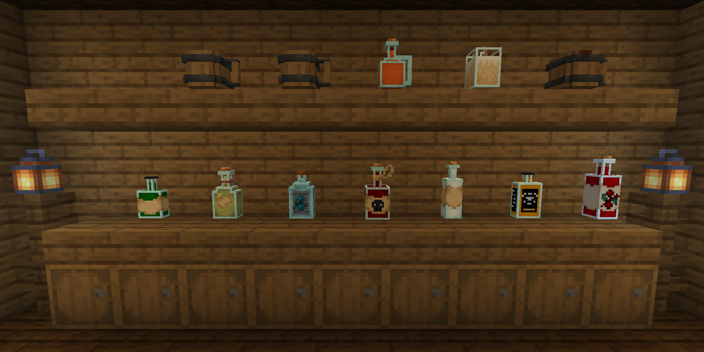
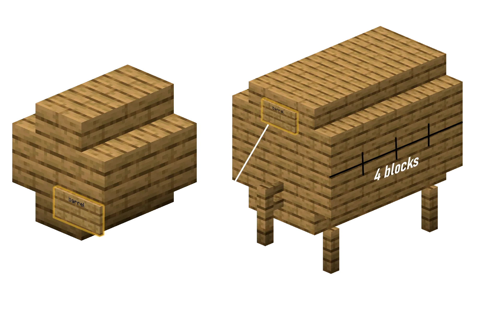

## 釀酒坊是什麼？

**釀酒坊**讓你釀造酒、咖啡，以及提供飽和效果、可以代替固體食物的**營養飲品**。這些是日常飲品，不是非凡魔藥，魔藥見[煉製與魔藥](/zh-tw/magic/brewing/)。

大多數飲品都有自己的 3D 瓶子模型。

## 釀造是怎樣進行的？

一瓶完美的 5 星飲品最多需要四個步驟：

1. **發酵**，把材料放進加熱的煉藥鍋裡煮一段規定的時間，然後用玻璃瓶裝起來。
2. **蒸餾**，在釀造台裡加入熒石粉蒸餾混合物。只有高度烈酒需要這一步。
3. **陳釀**，把瓶子放在木桶裡陳放好幾個 Minecraft“年”。
4. **封存**，在飲品封存台裡封存成品，讓它的品質和年份永久固定。

## 煮沸

每種飲品都從一口沸騰的煉藥鍋開始。

1. 把一口裝滿水的煉藥鍋放在熱源上，例如營火、火、岩漿塊或熔岩。
2. 拿著配方裡的材料右鍵點選煉藥鍋。
3. 拿著**時鐘**右鍵點選沸騰的煉藥鍋，可以看到材料已經煮了多久。氣泡粒子的顏色也會隨時間變化，所以不用時鐘也能掌握配方的時間。
4. 煮好後，拿著空的**玻璃瓶**右鍵點選煉藥鍋，裝起基礎混合物。

## 蒸餾

烈酒需要蒸餾。

1. 把煮好的瓶子放進**釀造台**下面的三個格子裡。
2. 在最上面的格子裡放**熒石粉**。蒸餾時它會被消耗。
3. 在釀造台裡每過一遍，就算一次“蒸餾”。蒸餾過度會降低品質，甚至毀掉飲品。

## 木桶陳釀

陳釀會提升品質，並根據木桶的木材改變飲品的描述和風味。需要雲杉木桶的配方，只有在完全用雲杉建造的木桶裡才能達到最高品質。

飲品在登記過的木桶裡會自己陳釀。每個 Minecraft“年”相當於**現實中的 20 分鐘**。

## 木桶結構

你可以用 13 種材料中的任意一種建造兩種大小的木桶，分別是白樺、橡木、叢林、雲杉、金合歡、深色橡木、緋紅、詭異、紅樹、櫻花、竹、蒼白橡木和切制銅塊。

普通的 Minecraft **木桶**方塊也能陳釀飲品。它最多裝 6 瓶，算作橡木。

### 小木桶（可裝 9 瓶）

1. 在地面上用 4 個你選擇的木樓梯擺成 2x2 的正方形，樓梯朝內。
2. 在它們正上方再放 4 個樓梯，同樣朝內，組成一箇中空的 2x2x2 方塊。
3. 在正面放一塊告示牌，在第一行寫上 `barrel`。
4. 右鍵點選告示牌進行登記。你應該會在聊天欄看到 `Barrel created!`。

### 大木桶（可裝 27 瓶）

1. 在地面上放 4 根柵欄，作為一個 3x3x4 圓筒的支腳。
2. 建造一個橫放的圓筒，寬 3 格，長 4 格：
    - **底層。**左邊 4 個樓梯，右邊 4 個樓梯，中間一排 4 塊木板。
    - **中層。**左邊 4 塊木板，右邊 4 塊木板，正面中間 1 塊木板，背面中間 1 塊木板。中心保持中空。
    - **頂層。**左邊 4 個樓梯，右邊 4 個樓梯，中間一排 4 塊木板。
3. 在正面底部中間的木板上放一根柵欄。這就是龍頭。
4. 在龍頭正上方的中間木板上放一塊告示牌，在第一行寫上 `barrel`。
5. 右鍵點選告示牌進行登記。

## 封存台

沒封存的飲品放在物品欄或儲物裡時會一直變化。封存會鎖定飲品的品質並讓它停止陳釀，所以在出售或儲存之前，先把成品封存起來。

封存台放下來是一個**煙燻爐**方塊，但普通的煙燻爐無法封存飲品。在工作台的最上面一行放 **2 個玻璃瓶**，下面放 **4 塊木板**來製作它。把成品飲品放進封存台，點選即可封存。

## 醉酒與宿醉機制

酒精飲品會提高你的醉酒百分比，帶來下面這些效果：

1. **踉蹌。**你會朝隨機的方向踉蹌。
2. **醉話。**你的聊天訊息會變得含糊不清。S 會變成 `sh`，單詞會被打亂，你還會隨機打嗝（`*hic*`）或打飽嗝（`*burp*`）。
3. **醉酒告示牌。**你在告示牌上寫的字會變得亂七八糟。
4. **嘔吐。**如果酒精含量太高，你會吐出來，掉出一些你撿不起來的物品，例如 `SOUL_SAND`、`ROTTEN_FLESH` 和 `BEETROOT`。
5. **醒來。**如果你醉得很厲害時下線，回來時可能會在管理團隊設定的某個醒來地點“醒來”。醉得極其厲害時，你可能還要試好幾次才能登入。

宿醉在你下線後會被記住 **7 天**，所以下線並不能治好它。

### 醒酒

下面這些物品可以降低醉酒程度或治好宿醉：

| 物品 | 降低的酒精值 |
|:---|:---|
| 金蘋果 | **10** |
| 麵包 | **4** |
| 蜂蜜瓶 | **3** |
| 牛奶桶 | **2** |
| 水桶 | **2** |
| 胡蘿蔔 | **2** |

## 配方書

嚴格按照配方操作，就能得到 **5 星品質**的飲品。**陳釀**一欄裡的 "-" 表示飲品裝瓶後馬上就能喝。

如果飲品毀了，把滑鼠懸停在它上面。提示框會給出類似 `Too much time in the oven...` 或 `One of the ingredients doesn't taste good...` 的提示，幫你修正配方。

### 飽和與代替食物的飲品

這些飲品會給你**飽和**效果，所以你可以不吃固體食物。

| 名稱 | 材料 | 煮沸時間 | 蒸餾次數 | 陳釀 | 藥水效果 | 描述 |
|:---|:---|:---:|:---:|:---:|:---|:---|
| **矮人黑啤**（Dwarven Stout） | 8 小麥，4 甜漿果，1 煤炭 | 10 分鐘 | 0 | 橡木（6 年） | 飽和 I-II 抗性提升 I（1-2 分鐘） 緩慢 I（15 秒） | 一種濃重的煙燻黑啤，喝起來有泥土和爐火的味道。非常頂飽。 |
| **液體面包**（Liquid Bread） | 4 麵包，4 小麥，2 糖 | 6 分鐘 | 0 | 白樺（2 年） | 飽和 II-III 生命恢復 I（10-30 秒） | 終極生存飲品，齋戒的修士最愛喝。名副其實的液體面包。 |
| **精靈蜂蜜酒**（Elven Honeymead） | 8 甘蔗，2 蜂蜜瓶，4 西瓜片 | 5 分鐘 | 0 | 金合歡（15 年） | 飽和 II 迅捷 I（1-2 分鐘） 生命恢復 I-II（10-20 秒） | 甜得像液態的陽光。能讓旅人在荒野中撐上好幾天。 |
| **黃金盛宴靈藥**（Golden Feast Elixir） | 2 金胡蘿蔔，1 熒石粉，6 甜漿果，4 甘蔗 | 12 分鐘 | 1 | 雲杉（10 年） | 飽和 IV-V 發光 I（60 秒） 迅捷 I-II（30-60 秒） | 一種閃閃發光的神奇金色濃湯，連極度的飢餓都能治好。 |

### 混亂又搞笑的飲品

| 名稱 | 材料 | 煮沸時間 | 蒸餾次數 | 陳釀 | 藥水效果 | 描述 |
|:---|:---|:---:|:---:|:---:|:---|:---|
| **侏儒暈乎果汁**（Gnomish Giddy Juice） | 2 紅色蘑菇，2 棕色蘑菇，4 發光漿果，4 糖 | 4 分鐘 | 2 | 橡木（1 年） | 飽和 I 反胃 I-II（20-40 秒） 跳躍提升 II-IV（30-60 秒） 發光 I（30 秒） | 一種冒著泡、閃著光的粉色調變飲料。讓你跳得很高，開心得暈乎乎的！ |
| **海盜格羅格酒**（Pirate's Grog） | 6 海帶，10 甘蔗，6 西瓜片 | 8 分鐘 | 2 | 深色橡木（5 年） | 飽和 I-II 水下呼吸 I（1-2 分鐘） 村莊英雄 I（30 秒） | 又辣又鹹的格羅格酒，能趕走壞血病，讓你感覺自己是海盜王。 |
| **發光蘑菇伏特加**（Glowing Mushroom Vodka） | 10 馬鈴薯，3 紅色蘑菇，3 棕色蘑菇 | 18 分鐘 | 5 | - | 虛弱（80 秒） 反胃（27 秒） 夜視（50-80 秒） 失明（2-12 秒） 緩慢（3-10 秒） | 一種迷幻的飲品。真的會在黑暗中發光，還會扭曲現實。 |

### 經典啤酒與麥芽酒

| 名稱 | 材料 | 煮沸時間 | 蒸餾次數 | 陳釀 | 背景故事 / 描述 |
|:---|:---|:---:|:---:|:---:|:---|
| **小麥啤酒**（Wheatbeer） | 3 小麥 | 8 分鐘 | 0 | 白樺（2 年） | 清爽又爽口。 |
| **啤酒**（Beer） | 6 小麥 | 8 分鐘 | 0 | 任意（3 年） | 傳統的酒館麥芽酒。 |
| **黑啤酒**（Darkbeer） | 6 小麥 | 8 分鐘 | 0 | 深色橡木（8 年） | 烘烤過的濃郁麥芽風味。 |

### 葡萄酒、蜂蜜酒與蘋果酒

| 名稱 | 材料 | 煮沸時間 | 蒸餾次數 | 陳釀 | 藥水效果 | 描述 |
|:---|:---|:---:|:---:|:---:|:---|:---|
| **紅葡萄酒**（Red Wine） | 5 甜漿果 | 5 分鐘 | 0 | 任意（20 年） | 沒有 | 酒體飽滿，需要在木桶裡長時間陳釀。 |
| **蜂蜜酒**（Mead） | 6 甘蔗 | 3 分鐘 | 0 | 橡木（4 年） | 沒有 | 經典的蜂蜜風味酒。 |
| **蘋果蜂蜜酒**（Apple Mead） | 6 甘蔗，2 蘋果 | 4 分鐘 | 0 | 橡木（4 年） | 水下呼吸（150 秒） | 香甜的蘋果蜂蜜酒，能幫你在水下呼吸。 |
| **蘋果酒**（Apple Cider） | 14 蘋果 | 7 分鐘 | 0 | 任意（3 年） | 沒有 | 香甜清爽的蘋果酒。 |

### 烈酒

需要蒸餾的高度酒。在老湯姆金酒裡，“藍色花朵”指的是矢車菊或蘭花。

| 名稱 | 材料 | 煮沸時間 | 蒸餾次數 | 陳釀 | 藥水效果 | 描述 |
|:---|:---|:---:|:---:|:---:|:---|:---|
| **卡爾瓦多斯（蘋果烈酒）**（Calvados） | 12 蘋果 | 16 分鐘 | 3 | 金合歡（6 年） | 沒有 | 最差時酸得像酸液，最好時是一款上等白蘭地。 |
| **蘇格蘭威士忌**（Scotch Whiskey） | 10 小麥 | 10 分鐘 | 2 | 雲杉（18 年） | 沒有 | 一款帶有濃郁木香的單一麥芽威士忌。 |
| **金朗姆酒**（Golden Rum） | 18 甘蔗 | 6 分鐘 | 2 | 橡木（14 年） | 抗火（20-100 秒） 中毒（0-30 秒） | 溫暖的香料金朗姆酒，能提供短暫的防火保護。 |
| **俄羅斯伏特加**（Russian Vodka） | 10 馬鈴薯 | 15 分鐘 | 3 | - | 虛弱（15 秒） 中毒（10 秒） | 一種辛辣的馬鈴薯烈酒。品質差的時候幾乎沒法喝。 |
| **老湯姆金酒**（Old Tom Gin） | 9 小麥，6 藍色花朵，1 蘋果 | 6 分鐘 | 2 | - | 沒有 | 帶有杜松子的細膩風味。 |
| **陳年龍舌蘭**（Tequila Anejo） | 8 仙人掌 | 15 分鐘 | 2 | 白樺（12 年） | 沒有 | 沙漠之魂，在白樺木中陳釀。 |
| **烈性苦艾酒**（Strong Absinthe） | 15 草 | 3 分鐘 | 6 | - | 中毒（15-25 秒） | 高度草本烈酒。毒性很強，但勁也很大。 |
| **綠色苦艾酒**（Green Absinthe） | 17 草，2 毒馬鈴薯 | 5 分鐘 | 6 | - | 中毒（25-40 秒） 瞬間傷害 II 夜視（40-60 秒） | 一種看起來就有毒的青綠色烈酒。會扭曲視線。 |
| **黃金伏特加**（Golden Vodka） | 10 馬鈴薯，2 金粒 | 18 分鐘 | 3 | - | 虛弱（28 秒） 中毒（4 秒） | 閃閃發光的金色伏特加。 |
| **烈焰威士忌**（Blazing Whiskey） | 10 小麥，2 烈焰粉 | 12 分鐘 | 3 | 雲杉（18 年） | 沒有 | 喝下去時嘴裡有一種灼燒感！ |

### 特色飲品與醒酒飲品

這些飲品大多不含酒精，或者能幫你醒酒。蛋黃酒是例外，它含有酒精。

| 名稱 | 材料 | 煮沸時間 | 蒸餾次數 | 陳釀 | 藥水效果 | 描述 |
|:---|:---|:---:|:---:|:---:|:---|:---|
| **馬鈴薯湯**（Potato Soup） | 5 馬鈴薯，3 草 | 3 分鐘 | 0 | - | 瞬間治療（品質越高越強） | 熱乎乎的營養湯，能恢復生命值。 |
| **濃咖啡**（Strong Coffee） | 12 可可豆，2 牛奶桶 | 2 分鐘 | 0 | - | 迅捷（30-140 秒） 生命恢復（2-5 秒） 酒精 -6% | 清醒頭腦、快速醒酒的最佳選擇。 |
| **蛋黃酒（蛋酒）**（Advocaat） | 5 雞蛋，2 糖，1 牛奶桶 | 2 分鐘 | 0 | 任意（3 年） | 沒有 | 用生雞蛋做的奶油蛋黃酒。含酒精。 |
| **熱巧克力**（Hot Chocolate） | 3 曲奇 | 2 分鐘 | 0 | - | 急迫（40 秒） | 熱乎乎的甜可可，給你挖礦的力氣。 |
| **冰咖啡**（Iced Coffee） | 8 曲奇，4 雪球，1 牛奶桶 | 1 分鐘 | 0 | - | 迅捷（10 秒） 生命恢復（30 秒） 酒精 -8% | 快速醒酒的最佳飲品。冰涼又香甜。 |
