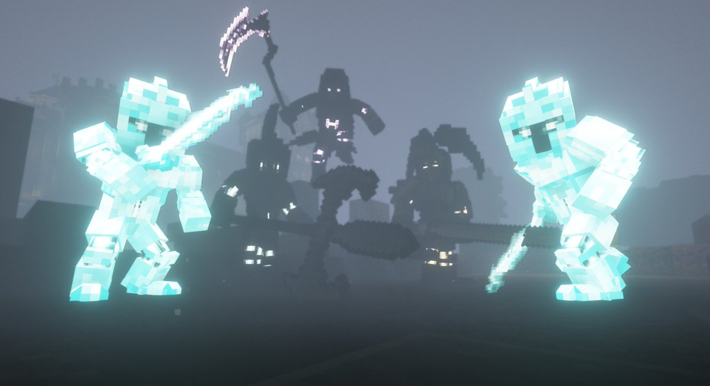
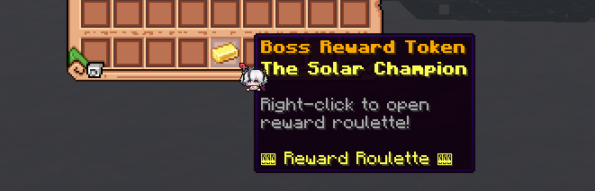
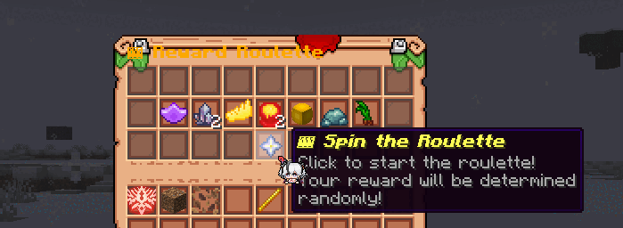
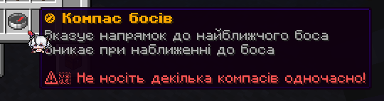

裂隙首領（以前叫守護者）是世界首領，22 條途徑各有一位，按固定的每週時間表出現在主世界。每位幫忙擊敗首領的玩家，都有機會獲得這條途徑的配方、非凡特性和材料。

## 裂隙首領什麼時候生成？

每位首領都有自己每週的時間段，通常一週兩次。首領出現前 **30、15、5 和 1 分鐘**，全服都會在聊天欄收到警告。

| 日期 | 首領（伺服器時間） |
|---|---|
| 星期一 | 不眠者 10:00，刺客 16:00，耕種者 18:00，律師 20:00，學徒 22:00，窺秘人 22:00 |
| 星期二 | 偷盜者 10:00，占卜家 16:00，藥師 22:00，怪物 22:00 |
| 星期三 | 秘祈人 10:00，閱讀者 10:00，囚犯 14:00，收屍人 14:00，通識者 16:00，獵人 22:00，歌頌者 23:00 |
| 星期四 | 仲裁人 10:00，水手 16:00，耕種者 18:00，戰士 18:00，罪犯 22:00，窺秘人 22:00，觀眾 22:00 |
| 星期五 | 不眠者 10:00，律師 16:00，刺客 16:00，學徒 22:00，藥師 22:00 |
| 星期六 | 偷盜者 10:00，囚犯 14:00，占卜家 14:00，閱讀者 14:00，怪物 18:00，戰士 20:00，秘祈人 22:00 |
| 星期日 | 通識者 10:00，獵人 14:00，仲裁人 16:00，收屍人 18:00，歌頌者 19:00，罪犯 22:00，水手 22:00 |

管理團隊可以更改時間表，所以請以聊天欄的警告為準，而不是這張表。

### 它們會出現在哪裡？

在主世界的一個隨機地點，距離中心每個方向最遠 12,000 格。**首領指南針**可以帶你找到它。

## 哪位首領屬於哪條途徑？

| 途徑 | 首領 | 狂怒於 | 僅限魔法於 |
|---|---|---|---|
| 罪犯途徑 | 深淵恐魔（The Abyssal Horror） | 35% | 20% |
| 律師途徑 | 帝國君主（The Imperial Sovereign） | 35% | 20% |
| 囚犯途徑 | 被縛吞噬者（The Chained Devourer） | 30% | 20% |
| 不眠者途徑 | 暗影先驅（The Shadow Harbinger） | 30% | 20% |
| 收屍人途徑 | 永恆死神（The Eternal Reaper） | 30% | 20% |
| 刺客途徑 | 緋紅魔女（The Crimson Demoness） | 35% | 25% |
| 學徒途徑 | 維度守門人（The Dimensional Gatekeeper） | 35% | 20% |
| 偷盜者途徑 | 悖論實體（The Paradox Entity） | 35% | 20% |
| 占卜家途徑 | 瘋狂小丑（The Jester of Madness） | 50% | 20% |
| 秘祈人途徑 | 懸吊之魂（The Suspended Soul） | 30% | 25% |
| 窺秘人途徑 | 孤獨賢者（The Solitary Sage） | 25% | 20% |
| 仲裁人途徑 | 神聖仲裁者（The Divine Arbitrator） | 30% | 20% |
| 藥師途徑 | 月之女皇（The Lunar Empress） | 40% | 25% |
| 耕種者途徑 | 原初之母（The Primal Mother） | 30% | 20% |
| 通識者途徑 | 巔峰工匠（The Apex Crafter） | 30% | 20% |
| 獵人途徑 | 火焰祭司（The Flame Cleric） | 40% | 20% |
| 歌頌者途徑 | 太陽勇士（The Solar Champion） | 25% | 15% |
| 戰士途徑 | 巨像守護者（The Colossal Guardian） | 40% | 15% |
| 水手途徑 | 風暴暴君（The Storm Tyrant） | 35% | 15% |
| 觀眾途徑 | 心靈先知（The Mind Seer） | 40% | 15% |
| 怪物途徑 | 命運編織者（The Fate Weaver） | 30% | 20% |
| 閱讀者途徑 | 高塔建築師（The Tower Architect） | 30% | 25% |

## 戰鬥是怎樣進行的？

首領戰分為三個階段：

1. **普通。**首領以全部實力戰鬥。
2. **狂怒。**當它的生命值降到狂怒閾值時，首領會**回血**到生命值的 60% 到 80%，並召喚 **2 名野生非凡者護衛**。如果狂怒階段拖了 10 分鐘，它造成的傷害會變成 x1.2 到 x1.5。
3. **最終階段（僅限魔法）。**在生命值 15% 到 25% 時，首領會**免疫物理傷害**，只有法術能傷到它。它還會再召喚 **3 名護衛**。

:::caution[帶上非凡者]
沒有施法者的隊伍無法打完首領。它召喚的護衛會按戰鬥中最強的非凡者來縮放。
:::

### 首領戰難在哪裡？

| 規則 | 說明 |
|---|---|
| 強度縮放 | 首領按附近玩家的**非凡總戰力**縮放，而不是按人數。每位玩家的戰力是序列9 = 1，8 = 1.6，7 = 2.6，6 = 4.2，5 = 6.8，4 = 11，3 = 18，2 = 29，1 = 47。普通人算 0.35 |
| 同途徑抗性 | 首領受到它自己途徑能力的傷害只有 **35%** |
| 每次命中的傷害上限 | 一次命中最多隻能打掉首領 **4%** 的生命值 |
| 首領的攻擊 | 首領一次攻擊最多造成 60 點傷害 |
| 靈性流失 | 在 40 格以內，你**每 8 秒失去 6% 的靈性**（後面的階段更多） |
| 瘋狂值 | 在 40 格以內，你每 15 秒增加一次瘋狂值（後面的階段更多，序列4及更強的非凡者只增加一半） |
| 不能飛行 | 在首領附近 10 秒後，飛行就會失效 |

## 擊敗首領能得到什麼？

做出貢獻的玩家會得到一枚或多枚**首領獎勵代幣**，以首領的名字命名（例如 "Boss Reward Token: The Solar Champion"）。你在戰鬥中的貢獻越大，得到的代幣越多。代幣可以交易或儲存。

右鍵點選代幣，開啟**獎勵輪盤**並轉動它。獎池裡有這條途徑從序列9到序列1的配方、非凡特性和材料。較弱的物品比強的物品常見得多。

擊殺首領也會透過 World 來源給你扮演。

## 怎樣找到首領？

**首領指南針**指向最近的活躍首領。

在首領出現期間右鍵點選它來開啟。它會工作 **30 分鐘**，顯示方向和大致距離，你靠近後它會消失。一次只帶一個。戰鬥通行證的獎勵裡有首領指南針。

