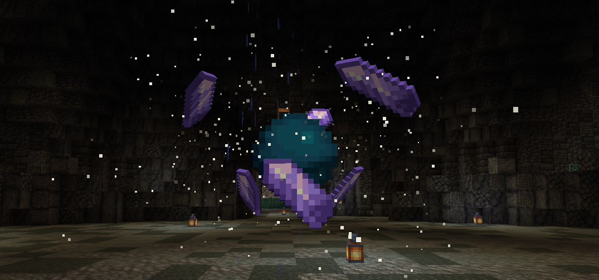
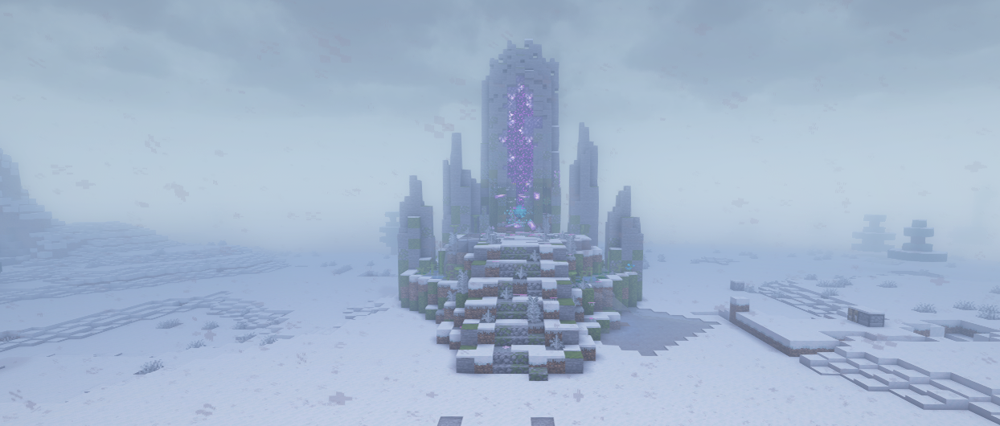

import {Figure} from '~/components/mdx';
import subspaceMenu from '~/assets/dungeons/subspace-menu.webp';
import chooseDifficulty from '~/assets/dungeons/choose-difficulty.webp';
import cardShop from '~/assets/dungeons/helping-card-shop.webp';

地牢是獨立的副本世界，隊伍透過主世界裡的一道**裂隙**進入。你要帶著職業裝備一路打過各個房間，直到最終首領，然後帶著戰利品、援助卡和扮演離開。每位玩家每次進入只有**一條命**。

## 有哪些地牢？

| 地牢 | 隊伍人數 | 地牢戰力 | 場景 |
|---|---|---|---|
| **戰慄空洞**（The Shivering Hollow） | 4 | 0 | 一個冰封的地下洞穴 |
| **餘燼復燃**（Embers Resurgence） | 5 | 100 | 一座火山要塞 |
| **林冠之根**（Root of the Canopy） | 4 | 240 | 一座由巨大樹根構成的迷宮 |
| **塵埃城塞**（The Dust Citadel） | 3 | 450 | 一座被掩埋的沙漠堡壘 |

戰慄空洞和餘燼復燃各有兩個入口，其他地牢各有一個。還不是非凡者的玩家也可以進入戰慄空洞。

## 怎樣找到地牢？

輸入 `/subspace`。選單會列出每個地牢、每個入口裂隙的座標、你和地牢的戰力對比，以及你的冷卻時間和今天剩餘的援助卡次數。

<Figure src={subspaceMenu} alt="Ventures to the Subspace 選單，塵埃城塞的提示框顯示戰力等級 450 和一個入口" caption="/subspace 選單。把滑鼠懸停在地牢上，可以看到它的戰力等級和入口。" contain />

裂隙是一根閃爍的粒子柱。和你的隊伍一起走進去就能開始。

## 怎樣進入地牢？

1. 用 `/party` **組建隊伍**並邀請你的朋友。`/ready` 和 `/leave` 用來管理排隊。
2. **前往裂隙**並走進去。
3. 在 "Choose Difficulty" 介面**選擇難度**。
4. 地牢載入後**選擇職業**。如果你沒有及時選擇，系統會給你分配一個。

<Figure src={chooseDifficulty} alt="Choose Difficulty 介面，普通難度的提示框顯示需要 450 戰力，造成和受到的傷害都是 x1" caption="Choose Difficulty。把滑鼠懸停在某個檔位上，可以看到它需要的戰力。" contain />

如果你的隊伍人數少於地牢的隊伍人數，會詢問你是否 **Enter Understaffed?** 只有你的戰力比地牢戰力高出不超過 150 時才允許這樣做。戰力過高的玩家必須帶滿一整隊。

:::note[空著手進去]
如果隊伍裡有人攜帶了某些資源，地牢不會開始（"Someone in the party is carrying resources!"）。把貴重物品留在家裡。
:::

## 什麼是地牢戰力？

你的戰力來自你的序列：

| 序列 | 9 | 8 | 7 | 6 | 5 |
|---|---|---|---|---|---|
| 戰力 | 30 | 60 | 100 | 150 | 220 |

| 序列 | 4 | 3 | 2 | 1 | 0 |
|---|---|---|---|---|---|
| 戰力 | 320 | 450 | 600 | 800 | 999 |

只有你的戰力比地牢戰力**最多低 29**，你才能進入。戰力不足也會削弱你。在低於 10、20 和 29 時分階段生效，你造成的傷害會下降（最低到 x0.4），受到的傷害會上升（最高到 x1.6）。戰力達到或超過地牢戰力時沒有懲罰。

## 難度檔位有哪些？

每個地牢都有四個檔位。越難的檔位給的扮演越多，援助卡也越好。

| 檔位 | 需要的戰力 | 你造成的傷害 | 你受到的傷害 |
|---|---|---|---|
| 普通（Normal） | 地牢戰力 | x1.0 | x1.0 |
| 進階（Advanced） | 地牢戰力 + 50 | x0.7 | x1.5 |
| 大師（Master） | 地牢戰力 + 150 | x0.5 | x1.8 |
| 宗師（Grandmaster） | 450（序列3）或以上 | x0.3 | x2.5 |

在大師和宗師檔位，你總會被當作戰力稍有不足來對待。

## 我多久能打一次地牢？

| 類型 | 頻率 | 你能得到什麼 |
|---|---|---|
| **真正的戰利品局** | 每個地牢每 **72 小時**一次 | 箱子和首領的戰利品 |
| **援助卡局** | 冷卻期間每個地牢**每天最多 2 次** | 箱子被封住。打完後你會得到 **1 張援助卡** |

大部分戰利品會以**碎片**（"Shard of ..."）的形式掉落。手持足夠數量的碎片右鍵點選，就能把它們合成真正的物品。序列9的配方或魔藥需要 2 塊碎片，越強的物品需要越多，序列0最多需要 9 塊。

### 地牢鑰匙是什麼？

| 鑰匙 | 效果 |
|---|---|
| **簡易鑰匙** | 重置你自己在某個地牢的戰利品冷卻 |
| **高階鑰匙** | 重置你隊伍的冷卻（最多到地牢的隊伍人數），讓這一局變成真正的戰利品局，並讓援助卡翻倍 |

右鍵點選鑰匙，然後選擇地牢。鑰匙來自戰鬥通行證和商店。

## 援助卡有什麼用？

每張**援助卡**都屬於一個地牢和一個檔位。右鍵點選它，開啟**援助卡商店**，用卡片兌換獎勵。例如，餘燼復燃的大師檔位：

<Figure src={cardShop} alt="援助卡商店，餘燼復燃大師檔位的材料兌換代幣提示框，花費 8 張援助卡" caption="援助卡商店。把滑鼠懸停在獎勵上，可以看到它需要多少張卡。" contain />

| 獎勵 | 卡片 |
|---|---|
| 材料代幣 | 8 |
| 配方代幣（序列6） | 12 |
| 魔藥代幣（序列6） | 16 |
| 扮演之瓶（10,000） | 20 |
| 抗失控護符 | 24 |
| 儀式之書（一階） | 32 |

林冠之根和塵埃城塞的商店獎勵以戰利品碎片的形式發放，而不是完整的物品。餘燼復燃和林冠之根的宗師商店還出售[途徑轉換信物](/zh-tw/guides/special-items/)。

## 地牢能給多少扮演？

打完地牢會透過 World 來源給你扮演。越難的檔位給得越多（進階 x1.25，大師 x1.5，宗師 x2）。所有地牢加起來，地牢扮演**每天最多 600**，在 UTC 午夜重置。

## 我應該選哪個職業？

| 職業 | 魔法傷害 | 物理傷害 | 說明 |
|---|---|---|---|
| **坦克** | x0.3 | x0.6 | 防禦高，會把怪物吸引到自己身上 |
| **法師** | x2.2 | x0.15 | 法術打得很痛，空手毫無用處 |
| **戰士** | x0.7 | x1.8 | 近戰強，但死得快 |
| **弓箭手** | x0.8 | x0.7 | 弓和弩造成 x2.2 傷害 |
| **輔助** | x1.0 | x0.8 | 魔法防禦強，可以使用全部增益 |

一支均衡的隊伍有一名坦克來拉住怪物，有適合你們非凡者的輸出，有條件的話再加一名輔助。

### 哪些能力在地牢裡被停用？

下面這些能力在地牢裡無效，分別是夢魘、夢魘世界、旅行家之門、放逐、絲線之手、絲線、紙人替身、口袋空間、神聖裝備、開鎖、怨魂化、木偶化和木偶附身。有些職業還會停用某些能力（"Your class cannot use this ability in the dungeon!"）。

## 關閉的裂隙是怎麼回事？

裂隙可能會處於關閉狀態，直到玩家一起削弱它。站在它附近，接受 "The node is too strong. You can try to weaken it. [Try?]"，然後在它吸收你的碎片期間撐過防守戰。目前所有地牢的裂隙都是開放的。
